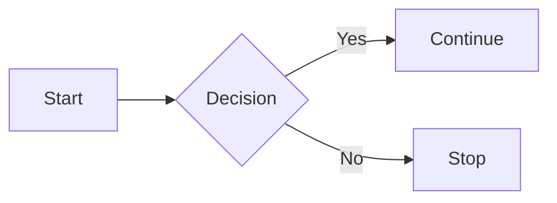

# mermaid 12.3.0

## Overview

Mermaid is a JavaScript-based diagramming tool. A diagram is plain text that starts with a diagram-type keyword on its first line, followed by the diagram definition. Rendered output is SVG. Line comments start with `%%`.

Every diagram definition can begin with a YAML **frontmatter** block (between `---` lines) carrying `title`, `displayMode`, and a `config` object that overrides the site-wide configuration for that diagram only.

Since v12.0.0, appearance is controlled by three keys:

- `theme` — colour scheme (`default`, `base`, `dark`, `forest`, `neutral`, `redux`, `redux-color`, `redux-dark`, `redux-dark-color`, `neo`, `neo-dark`, …)
- `look` — visual style: `classic` (original), `neo` (flat, rounded, subtle shadows), `handDrawn` (sketch-like)
- `layout` — layout algorithm: `elk` (bundled with mermaid v12, was opt-in `@mermaid-js/layout-elk` before) or `dagre` (classic); `swimlane` for swimlane diagrams

Per-diagram defaults changed in v12.0.0. These ten types now default to the `redux-color` theme, the `neo` look, and ELK layout (config key in parentheses): `flowchart` (flowchart), `sequenceDiagram` (sequence), `stateDiagram` (state), `classDiagram` (class), `erDiagram` (er), `requirementDiagram` (requirement), `usecase-beta` (usecase), `venn-beta` (venn), `agentflow-beta` (agentflow), `swimlane-beta` (swimlane). Every other diagram type still defaults to the `default` theme and `classic` look. Anything you set explicitly wins; priority is (1) the diagram's own frontmatter/directive, (2) `mermaid.initialize()`, (3) the diagram type's default, (4) the global default.

## Usage

### Write a diagram

Wrap the definition in a ` ```mermaid ` fenced block in markdown, or in a `<pre class="mermaid">` tag in HTML:

````markdown

````

The first line inside the fence selects the diagram type. Unknown words and misspellings break a diagram; unknown parameters fail silently.

### Diagram types at a glance

| Keyword | Diagram |
|---|---|
| `flowchart` / `graph` | Flowcharts and graphs |
| `sequenceDiagram` | Sequence diagrams |
| `zenuml` | Sequence diagrams with ZenUML syntax |
| `stateDiagram-v2` / `stateDiagram` | State diagrams (v2 is the newer renderer) |
| `classDiagram` | UML class diagrams |
| `gantt` | Gantt charts |
| `erDiagram` | Entity-relationship diagrams |
| `pie` | Pie and donut charts |
| `gitGraph` | Git commit graphs |
| `journey` | User journey diagrams |
| `mindmap` | Mind maps |
| `timeline` | Timelines |
| `xychart` | XY charts (bar and line) |
| `quadrantChart` | Four-quadrant charts |
| `sankey` | Sankey flow diagrams |
| `block` | Block diagrams with manual layout |
| `packet` | Network packet diagrams |
| `kanban` | Kanban boards |
| `requirementDiagram` | SysML requirement diagrams |
| `C4Context` / `C4Container` / `C4Component` / `C4Dynamic` / `C4Deployment` | C4 model (plantUML-compatible) |
| `agentflow-beta` | Agentic workflows (beta) |
| `architecture-beta` | Cloud architecture (beta) |
| `cynefin-beta` | Cynefin framework maps (beta) |
| `eventmodeling` | Event modeling timelines |
| `ishikawa-beta` | Fishbone / cause-and-effect (plain `ishikawa` works too) |
| `radar-beta` | Radar / spider charts (beta) |
| `railroad-beta`, `railroad-ebnf-beta`, `railroad-abnf-beta`, `railroad-peg-beta` | Railroad / grammar diagrams (beta) |
| `swimlane-beta` | Swimlane process diagrams (beta) |
| `treeView-beta` | Directory-style tree views (beta) |
| `treemap-beta` | Hierarchical treemaps (plain `treemap` works too) |
| `usecase-beta` | UML use case diagrams (beta) |
| `venn-beta` | Venn diagrams (beta) |
| `wardley-beta` | Wardley strategy maps (beta) |

### HTML integration

Two elements: the definition in `<pre class="mermaid">` and an ES module import. Rendering starts automatically at page load.

```html
<pre class="mermaid">
  graph LR
    A --- B
    B --> C
</pre>
<script type="module">
  import mermaid from 'https://cdn.jsdelivr.net/npm/mermaid@12/dist/mermaid.esm.min.mjs';
</script>
```

`mermaid.initialize(config)` applies site-wide config (e.g. `{ startOnLoad: false, theme: 'forest', securityLevel: 'loose' }`). `mermaid.run(options)` re-renders on demand with `querySelector`, `nodes`, or `suppressErrors` options; `startOnLoad: false` prevents the automatic run. `mermaid.init` is deprecated since v10 — use `run`.

### JavaScript API

- `await mermaid.render(id, text)` returns `{ svg, bindFunctions }`; insert the SVG into the DOM, then call `bindFunctions(element)` to attach click/tooltip events.
- `await mermaid.parse(text)` validates syntax without rendering; returns the diagram type if valid, throws (or returns `false` with `parseOptions.suppressErrors`) if invalid.
- `mermaid.detectType(text)` returns the diagram type key for a text string without rendering.
- `mermaid.getRegisteredDiagramsMetadata()` lists registered diagram ids.

### v12.3.0 additions (from the 12.3.0 changelog)

- Flowchart edges accept a `step` number (`e1@{ step: 1 }`) — a dot travels the edges in step order; `flowchart.stepDuration` sets the seconds per step; `flowchart.stepNumbers: true` shows step badges. See the flowchart reference.
- New open-arrow and hollow-circle edge markers, and new BPMN element shapes (events, gateways, activities, data objects, data stores, annotations) — the repo's syntax docs do not document their token spellings yet; verify against the parser or test suite in this tag before using them.
- Edge IDs may no longer contain `[ ] ( ) { } |`; flowchart edge IDs now work regardless of whitespace after the node shape.
- `mindmap.colorBy: depth` opt-in coloring by hierarchy depth (added in 12.2.0).
- DOMPurify bumped to 3.4.17; bundled elkjs upgraded to 0.12.0.

## Gotchas

- **The word `end` breaks flowcharts and sequence diagrams** — lowercase `end` is a reserved terminator. Capitalize it (`End`) or wrap the label in quotes/parens. Same for `graph` in `graph TD` vs a node named `graph`.
- **`o` or `x` as the first letter of a node** — `A---oB` is parsed as a circle edge ending at B, not a node named `oB`. Add a space or capitalize.
- **Beta keywords are exact** — `radar`, `architecture`, `venn`, `wardley`, `cynefin`, `agentflow`, `swimlane`, `treeView`, `usecase`, `railroad` (and the three railroad notation keywords) require the `-beta` suffix. `ishikawa` and `treemap` work with or without it.
- **Frontmatter must start at column 0** — the opening `---` must be the only character on its line, and YAML inside must use consistent indentation; misspelled settings are silently ignored, malformed ones break the diagram.
- **`%%{ }%%` directives are deprecated** (since v10.5.0) — use frontmatter `config:` instead. Also avoid `{`/`}` inside `%%` comments; they confuse the directive parser.
- **Appearance changed in v12.0.0** — the ten types listed above render with the redux-color theme, neo look, and ELK layout by default. To restore the classic appearance, set `theme: default`, `look: classic` (and `layout: dagre` for flowchart/agentflow/requirement which also switched layout) in frontmatter or `initialize`.
- **ELK is now bundled** — since v12.0.0 the main `mermaid` package includes ELK; the `@mermaid-js/layout-elk` registration step is no longer needed. The **tiny** build still omits ELK and falls back to `dagre` (register the layout package there if you need ELK).
- **v12 bundles target ES2024** — Node.js >= 22.12.0 for the repo toolchain; published bundles aim at Safari 17.4+ browsers.
- **`securityLevel` defaults to `strict`** — HTML tags in text are encoded and click functionality is disabled. Enable clicks with `mermaid.initialize({ securityLevel: 'loose' })` (or `sandbox`, `antiscript`); this is the site owner's security decision.
- **Fonts** — dynamically loaded fonts must finish loading before rendering, or labels overflow; initialize on `document`/window load.
- **C4 layout is positional** — C4 has no full auto-layout; shape positions are adjusted by statement order. `UpdateLayoutConfig($c4ShapeInRow=…, $c4BoundaryInRow=…)` controls rows.

## References

Each reference covers one diagram type with syntax and source-verified examples:

- [01-usage-and-config.md](references/01-usage-and-config.md) — Deployment, JS API, themes, looks, layouts, frontmatter, directives, accessibility, security
- [02-flowchart.md](references/02-flowchart.md) — Nodes, shapes (incl. `@{ shape: }`), edges, edge IDs, animations, subgraphs, styling
- [03-sequenceDiagram.md](references/03-sequenceDiagram.md) — Participants, messages, activations, alt/loop/par/break, notes, styling
- [04-stateDiagram.md](references/04-stateDiagram.md) — States, transitions, composites, choice, forks, concurrency
- [05-classDiagram.md](references/05-classDiagram.md) — Classes, members, relationships, namespaces, interfaces, cardinality
- [06-gantt.md](references/06-gantt.md) — Tasks, sections, milestones, dates, durations, excludes
- [07-erDiagram.md](references/07-erDiagram.md) — Entities, cardinality, attributes, keys, subgraphs
- [08-pie.md](references/08-pie.md) — Pie and donut charts
- [09-gitGraph.md](references/09-gitGraph.md) — Commits, branches, merges, cherry-picks, orientation
- [10-userJourney.md](references/10-userJourney.md) — Sections, tasks, scores, actors
- [11-mindmap.md](references/11-mindmap.md) — Indentation hierarchy, shapes, icons, markdown strings
- [12-timeline.md](references/12-timeline.md) — Time periods, events, sections
- [13-xyChart.md](references/13-xyChart.md) — Bar and line charts on x/y axes
- [14-radar.md](references/14-radar.md) — Radar charts with axes and curves
- [15-quadrantChart.md](references/15-quadrantChart.md) — Four-quadrant scatter
- [16-sankey.md](references/16-sankey.md) — Flow links with values
- [17-block.md](references/17-block.md) — Manual grid layout, nested blocks, arrows
- [18-architecture.md](references/18-architecture.md) — Cloud architecture groups and services
- [19-c4.md](references/19-c4.md) — C4 context/container/component/dynamic/deployment
- [20-packet.md](references/20-packet.md) — Network packet bit fields
- [21-treemap.md](references/21-treemap.md) — Hierarchical rectangles with values
- [22-venn.md](references/22-venn.md) — Sets and unions
- [23-wardley.md](references/23-wardley.md) — Value chain maps with evolution
- [24-ishikawa.md](references/24-ishikawa.md) — Fishbone cause-and-effect
- [25-kanban.md](references/25-kanban.md) — Columns and tasks with metadata
- [26-requirementDiagram.md](references/26-requirementDiagram.md) — SysML requirements and elements
- [27-usecase.md](references/27-usecase.md) — Actors, use cases, boundaries, UML relationships
- [28-eventmodeling.md](references/28-eventmodeling.md) — Event modeling timelines and data
- [29-treeView.md](references/29-treeView.md) — Directory trees with box-drawing input
- [30-cynefin.md](references/30-cynefin.md) — Cynefin domains and transitions
- [31-railroad.md](references/31-railroad.md) — Grammar diagrams in EBNF, ABNF, PEG, IR
- [32-agentflow.md](references/32-agentflow.md) — Agentic workflows: flows, shapes, connectors
- [33-swimlanes.md](references/33-swimlanes.md) — Responsibility lanes with flowchart nodes
- [34-zenuml.md](references/34-zenuml.md) — ZenUML sequence syntax


Interactive demos

Interactive demos for every diagram type ship in the repo's `demos/` directory at the [mermaid@12.3.0 tag](https://github.com/mermaid-js/mermaid/tree/mermaid%4012.3.0/demos); the full docs tree lives in `docs/` at the same tag.
