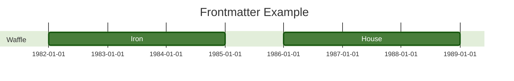
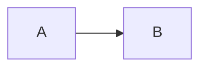

# Usage, deployment, and configuration

Sources: `docs/config/usage.md`, `docs/intro/getting-started.md`, `docs/intro/syntax-reference.md`, `docs/config/configuration.md`, `docs/config/theming.md`, `docs/config/directives.md`, `docs/config/accessibility.md` at mermaid@12.3.0.

## Deployment

Four ways to use Mermaid: Live Editor (mermaid.live), plugins/integrations (GitHub and GitLab render ` ```mermaid ` blocks natively), the JavaScript API, or adding `mermaid` as a dependency (`npm install mermaid`, yarn, pnpm; repo toolchain needs Node.js >= 22.12.0).

Minimal HTML page — a `<pre class="mermaid">` per diagram plus one ES module import; rendering starts automatically at page load:

```html
<pre class="mermaid">
  graph LR
    A --- B
    B --> C
</pre>
<script type="module">
  import mermaid from 'https://cdn.jsdelivr.net/npm/mermaid@12/dist/mermaid.esm.min.mjs';
</script>
```

Every diagram needs its own `<pre>` tag. An `id` attribute is added automatically to mermaid tags without one. Fonts: load recommended web fonts (Recursive Variable, Open Sans) before rendering or labels may render out of bounds.

## JavaScript API

```js
import mermaid from 'mermaid';

mermaid.initialize({ startOnLoad: false, theme: 'forest' });

// Render text to SVG; call bindFunctions after inserting into the DOM
const { svg, bindFunctions } = await mermaid.render('graphDiv', 'graph TB\na-->b');
element.innerHTML = svg;
bindFunctions?.(element);

// Validate without rendering (returns the diagram type; throws on error)
const ok = await mermaid.parse(textStr);

// Detect the diagram type of a text string
const type = mermaid.detectType(textStr); // e.g. 'sequence'

// Render all elements matching a selector
await mermaid.run({ querySelector: '.someOtherClass', suppressErrors: true });
```

`mermaid.run(options)` options: `querySelector` (default `.mermaid`), `nodes` (array-like of elements, overrides selector), `postRenderCallback`, `suppressErrors`. `mermaid.init` is deprecated since v10. `mermaid.parseError = fn` overrides the parse-error handler.

## Configuration sources (in priority order)

1. The diagram's own frontmatter `config:` or `%%{init}%%` directive.
2. `mermaid.initialize(siteConfig)`.
3. The diagram type's default (see per-diagram defaults below).
4. The global default (`theme: default`, `look: classic`, `layout: dagre`).

Within levels 1 and 2, a value scoped to one diagram type (e.g. `flowchart: { look: 'handDrawn' }`) wins over the global value set alongside it:

```js
mermaid.initialize({
  look: 'classic',      // everything is classic...
  flowchart: { look: 'handDrawn' }, // ...except flowcharts
  er: { theme: 'neutral' },
});
```

### Frontmatter

YAML block between `---` lines before the diagram keyword; the opening `---` must be the only character on its line. Supports `title`, `displayMode`, `config` (any non-secure config key), plus diagram-scoped namespaces such as `gantt:`:



Misspelled settings are silently ignored; malformed YAML breaks the diagram.

### Directives (deprecated)

`%%{init: { "theme": "dark" } }%%` still works but is deprecated since v10.5.0 — use frontmatter `config:` instead. JSON inside must use valid quoted key-value pairs. `init` and `initialize` are accepted and merged (last value wins). Avoid `{`/`}` inside `%%` comments — they confuse the directive parser.

## Appearance keys (v12)

- `theme` — `redux-color` (default for the ten v12-default types), `redux-dark-color`, `redux`, `redux-dark`, `default`, `neutral`, `dark`, `forest`, `neo`, `neo-dark`, `base`. Only `base` can be customized via `themeVariables` (hex colors only; names like `red` are not recognized). Derived variables (e.g. `primaryBorderColor`) adjust automatically when their source changes.
- `look` — `classic`, `neo`, `handDrawn`. `handDrawn` supports a `seed` for reproducible renders.
- `layout` — `elk` (bundled since v12), `dagre`, `swimlane` (for swimlane diagrams). ELK options live under `elk:` (`mergeEdges`, `straightenEdges`, `lineHops`, `preset: default|legacy|modelOrder|depthFirst`, `nodePlacementStrategy: SIMPLE|NETWORK_SIMPLEX|LINEAR_SEGMENTS|BRANDES_KOEPF`, `nodePlacementAlignment`, …).

Per-diagram defaults since v12.0.0 — these types use `redux-color` + `neo` + ELK (config key in parentheses): `agentflow`, `flowchart`, `swimlane`, `class`, `er`, `requirement`, `sequence`, `state`, `usecase`, `venn`. All other types: `default` theme + `classic` look. Restore the pre-v12 look per diagram:



Tiny build: `@mermaid-js/tiny` omits mindmap, architecture, KaTeX, lazy loading, and ELK; ELK diagrams there fall back to dagre. Register `@mermaid-js/layout-elk` via `mermaid.registerLayoutLoaders(elkLayouts)` if you need ELK in tiny.

## Security

`securityLevel` (set via `initialize` only): `strict` (default — HTML encoded, clicks off), `antiscript` (HTML allowed except script, clicks on), `loose` (HTML allowed, clicks on), `sandbox` (rendered in a sandboxed iframe).

## Accessibility

Mermaid auto-inserts `aria-roledescription` (set to the diagram type key) on the SVG. Author-provided accessible title/description add `<title>`/`<desc>` elements with `aria-labelledby`/`aria-describedby`. Syntax varies slightly per diagram type — the common forms are `accTitle:` / `accDescr:` lines (e.g. in flowchart, swimlanes, usecase, railroad) or frontmatter `title:`.
