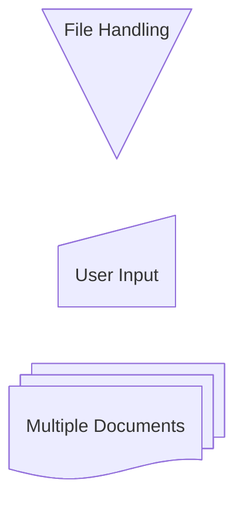
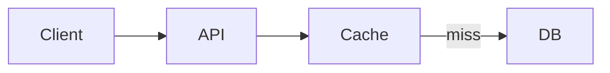
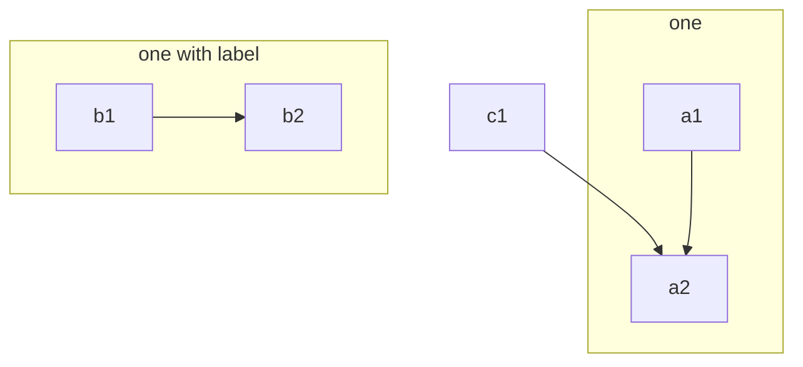
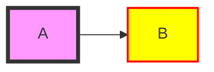
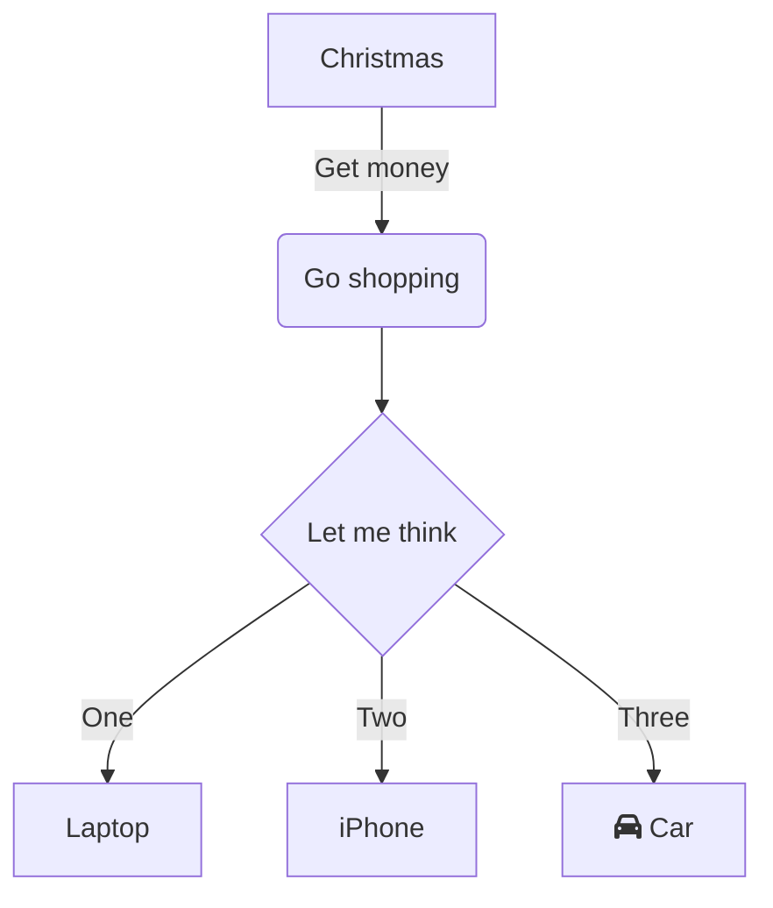
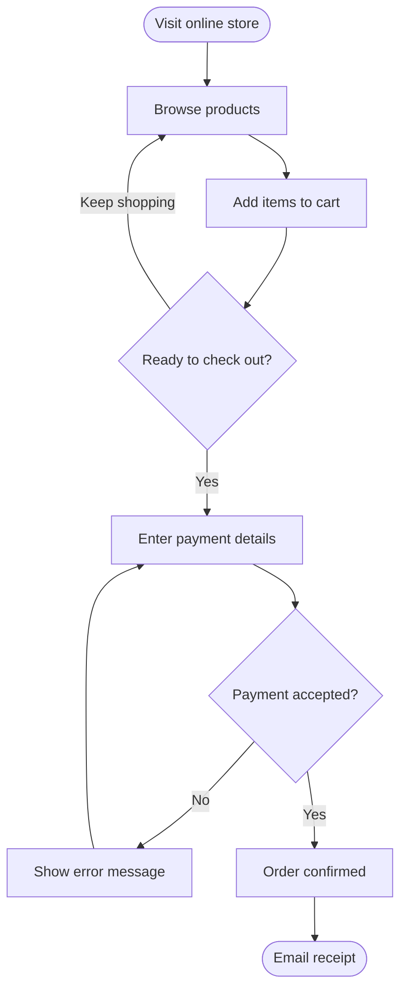
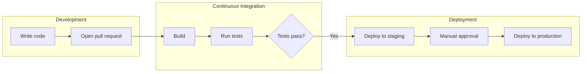

# Flowcharts

Keyword: `flowchart` (or `graph`). Directions: `TB`, `TD`, `BT`, `RL`, `LR`. Since v12.0.0 flowcharts default to the `redux-color` theme, `neo` look, and ELK layout.

Sources: `docs/syntax/flowchart.md`, `docs/syntax/all-examples.md` at mermaid@12.3.0.

## Node shapes

```mermaid
flowchart LR
    A[Text]            % rectangle (default is bare id)
    B(Rounded)
    C([Stadium])
    D[[Subroutine]]
    E[(Database)]
    F((Circle))
    G>Asymmetric]
    H{Rhombus}
    I{{Hexagon}}
    J[/Parallelogram/]
    K[\Parallelogram alt\]
    L[/Trapezoid\]
    M[\Trapezoid alt/]
    N(((Double circle)))
```

Text may differ from the id: `id1["This is the text in the box"]` — last definition wins. Wrap unicode in `"`. Markdown strings need double quotes plus backticks: `markdown["`This **is** _Markdown_`"]` (set `config: { htmlLabels: false }` when mixing).

### Expanded shapes (v11.3.0+)

`A@{ shape: rect }` selects from ~60 shapes by short name or alias (from the docs table): `rect` (process), `rounded` (event), `stadium` (terminal), `diam` (decision), `hex` (prepare conditional), `cyl` (database), `lean-r`/`lean-l` (data I/O), `doc`/`docs` (documents), `braces` (comment), `cloud`, `folder`, `person`, `f-circ` (junction), `fr-rect` (subprocess), `dbl-circ` (stop), `sm-circ` (start), `fr-circ` (stop, framed), `cross-circ` (summary), `text` (text block), `bow-rect` (stored data), `hourglass` (collate), `bolt` (com link), `flag` (paper tape), `win-pane` (internal storage), `h-cyl` (direct access storage), `lin-cyl` (disk storage), `curv-trap` (display), `div-rect` (divided process), `tri` (extract), `sl-rect` (manual input), `trap-t` (manual operation), `trap-b` (priority action), `notch-rect` (card), `tag-doc`/`tag-rect`, `console`, `browser`, `bucket`, `datastore`, `lin-doc`, `lin-rect`, `notch-pent` (loop limit), `flip-tri` (manual file), `odd`, `bang`, `delay`, `circle`, plus `label` to override the label:



## Edges

```mermaid
flowchart LR
    A-->B        % arrow
    A --- B      % open link
    A-.->B       % dotted
    A ==> B      % thick
    A ~~~ B      % invisible (layout hint)
    A -- text --> B        % labeled
    A---|text|B            % labeled
    A --o B                % circle edge (new arrow type)
    A --x B                % cross edge (new arrow type)
    A o--o B               % multi-directional
    B <--> C
    C x--x D
```

Chaining: `A -- text --> B -- text2 --> C`. Multiple endpoints with `&`: `A & B --> C & D`, `a --> b & c --> d`.

Minimum link length: extra dashes make a link span more ranks — `---->`, `====>`, `-...->` (see docs table: normal `---`, thick `===`, dotted `-.-`). For labels written in the middle of the link, add the extra dashes on the right side: `B -- Yes ----> E`.

### Edge IDs, animation, and steps (v11.10.0+/v12.3.0)

Prepend an ID with `@` to an edge: `A e1@--> B`. Edge IDs may no longer contain `[ ] ( ) { } |`.

```mermaid
flowchart LR
  A e1@--> B
  e1@{ animate: true }        % or { animation: fast } / { animation: slow }
```

Steps (v12.3.0+): a `step` number makes a dot travel the edges in order, looping; edges sharing a step play together; the active edge is highlighted (`edge-step-highlight` class); `flowchart.stepNumbers: true` shows step badges (`edge-step-badge`); `flowchart.stepDuration` sets seconds per step (default 1); hidden under `prefers-reduced-motion`.



`step` must be a positive whole number. `step` can combine with `animate`/`animation`.

## Subgraphs



- Explicit id: `subgraph id [label]`.
- `flowchart` (not `graph`) allows edges to and from subgraphs.
- Direction inside a subgraph: `direction LR` (limitation: nested direction only partially honored in some renderers — verify in the demo).
- Collapsible subgraphs since v11.17.0 (toggle in interactive render).
- Nesting shapes inside node text can confuse the parser — quote the text: `id1["This is the (text) in the box"]`.

## Styling



- `style <id> <css>` targets a node or edge ID.
- `classDef` + `class` apply shared styles; commas in CSS values must be escaped `\,`.
- Edge curve style per diagram (`flowchart: { curve: linear|basis|… }`) or per edge via edge IDs (v11.10.0+).
- FontAwesome icons: `F[fa:fa-car Car]`; register icon packs for custom packs (v11.7.0+).

## Verified examples

Basic with icon:



Online checkout:



CI/CD with subgraphs:



## Gotchas

- Lowercase `end` in a node label breaks the diagram — write `End`/`END` or quote it.
- `A---oB` is a circle edge, not a node `oB`.
- Escape entity codes with `#quot;`, `#9829;` etc. (base 10) inside quoted labels.
- `flowchart.htmlLabels` is deprecated since v11.12.3 — use the global `htmlLabels`.
- 12.3.0 changelog adds open-arrow and hollow-circle edge markers plus BPMN element shapes; the syntax docs do not spell out their tokens yet — verify against the parser/tests in this tag.
