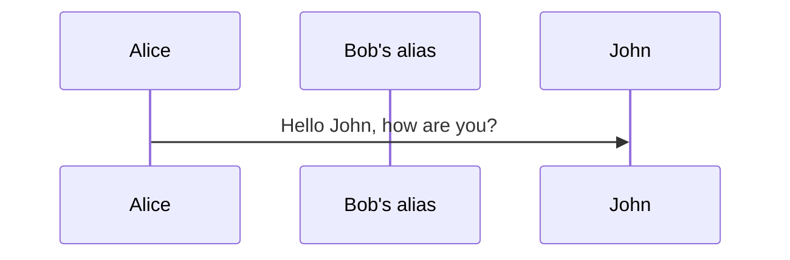
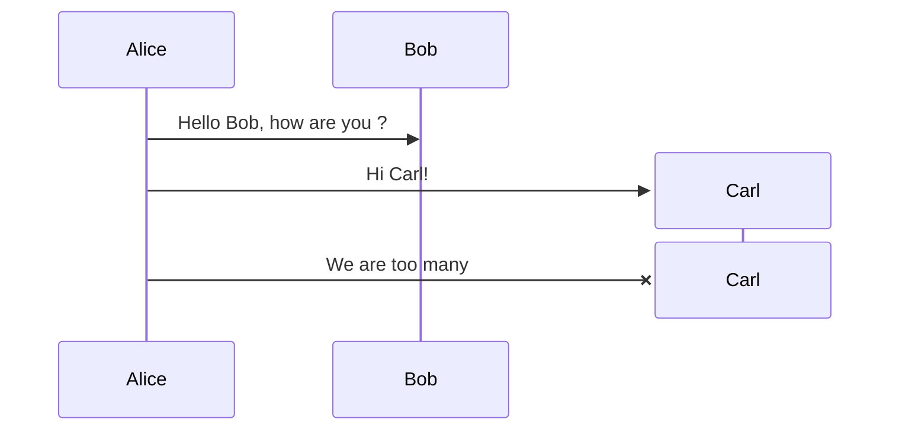
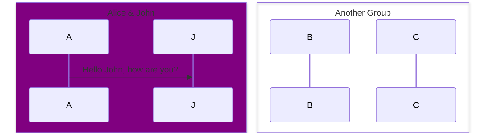
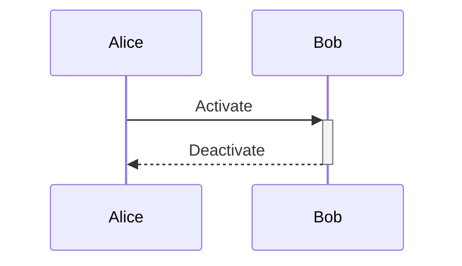
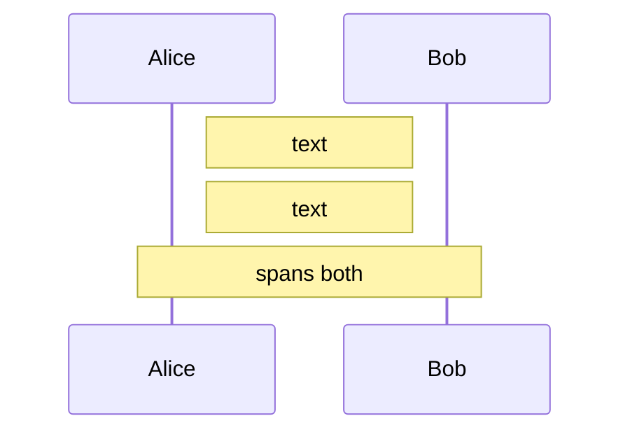
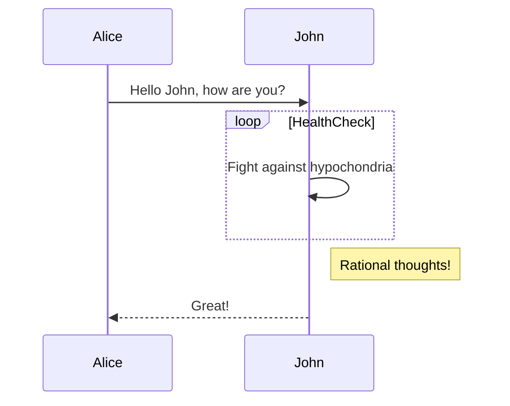
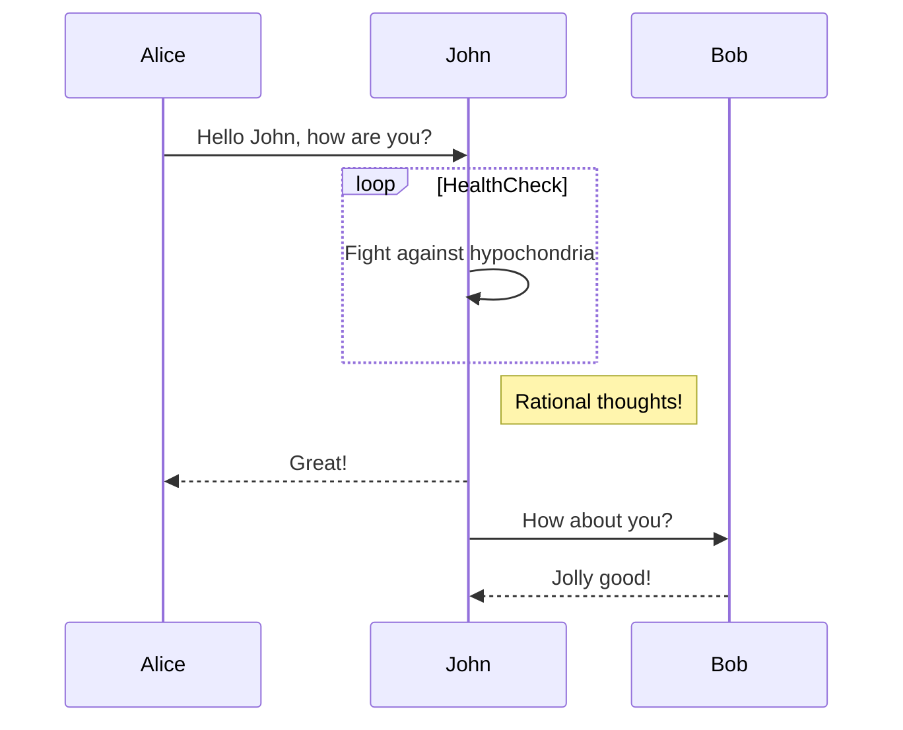
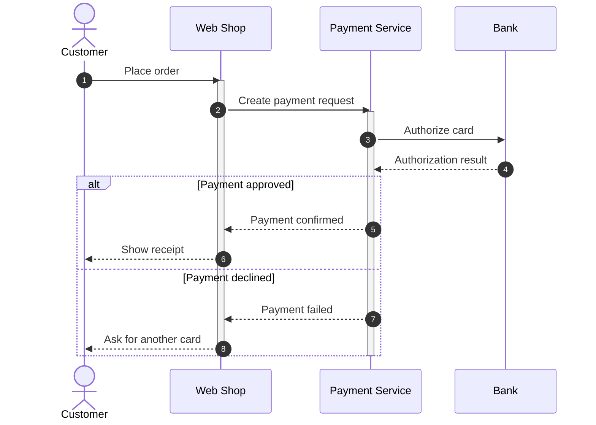

# Sequence diagrams

Keyword: `sequenceDiagram`. Since v12.0.0 sequence diagrams default to the `redux-color` theme, `neo` look, and ELK layout.

Sources: `docs/syntax/sequenceDiagram.md`, `docs/syntax/all-examples.md` at mermaid@12.3.0.

## Participants

- `participant <id> as <label>` sets a display alias.
- Typed participants: `actor`, `boundary`, `control`, `entity`, `database`, `collections`, `queue` declarations render typed shapes.
- Actor creation and destruction (v10.3.0+): `create participant B` / `create actor D as Donald` / `destroy Carl`. Only the recipient of a message can be created; sender or recipient can be destroyed. Destroying an actor ends its lifeline (`Alice-xCarl` draws the cross).

- Grouping in boxes: `box <color?> <description?>` … `end`. The color value comes before the description; hex colors are not supported (`#` is comment syntax). `box transparent Aqua` forces a transparent color when the group name is a color keyword.

## Messages

`[Actor][Arrow][Actor]:Message text`. Supported arrow types:

| Type | Meaning |
|---|---|
| `->` / `-->` | solid / dotted, no arrowhead |
| `->>` / `-->>` | solid / dotted arrowhead |
| `<<->>` / `<<-->>` | bidirectional arrowheads (v11.0.0+) |
| `-x` / `--x` | cross at the end |
| `-)` / `--)` | open arrow at the end (async) |

Half-arrows (v11.12.3+): solid/dotted variants like `-\|`, `-\|/`, `/\|-`, `\\-`, `-\\`, `-//`, `//-` give top/bottom half and stick arrowheads (increase dashes for dotted).

Central lifeline connections (v11.12.3+): messages can target a central point using `()` instead of an actor (see docs "Central Connections").

## Activations

`+`/`-` on the arrow head activates/deactivates the target; standalone `activate Bob` / `deactivate Bob` also work.

## Notes

Line breaks: ` `/` `. Escape characters with entity codes (`#quot;` etc.).

## Fragments

Fragments: `alt <label>` … `else <label>` … `end`, `loop <label>` … `end`, `par <label>` … `and <label>` … `end`, `critical` … `end`, `break` … `end`, `opt` … `end`. Background highlighting: `rect rgb(...)` … `end`. `autonumber` numbers messages (start/increment values since v11.15.0).

## Styling and config

`classDef` + `class` style participants and links (docs "Styling" section lists the CSS classes used). Config params via frontmatter `config.sequence`: `mirrorActors`, `width`, `height`, `messageAlign`, `useMaxWidth`, `rightAngles`, `showSequenceNumbers`, `wrap`, plus actor/signal/note font keys.

## Verified examples

Basic (README example):

Online payment flow (all-examples):

## Gotchas

- The word `end` breaks the diagram — wrap it in parens, quotes, or brackets in participant names/message text.
- `box` blocks end with plain `end`, not `end box`.
- `wrap: true` (config) wraps long messages instead of truncating.
