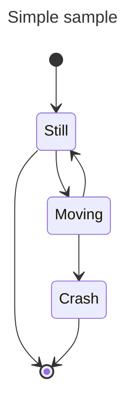
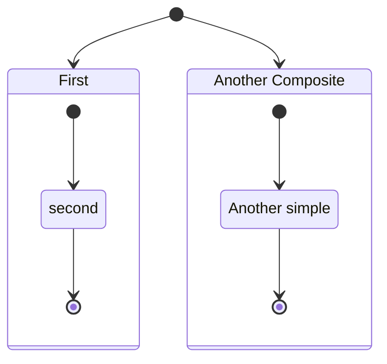
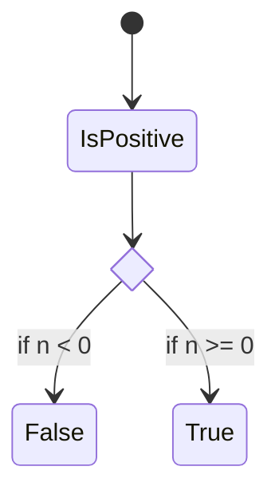
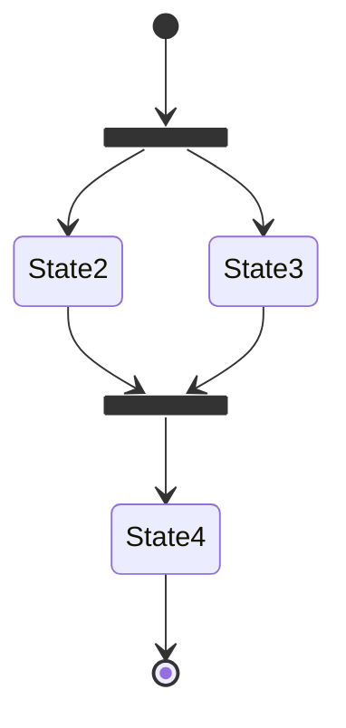
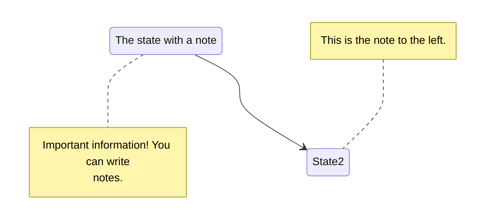
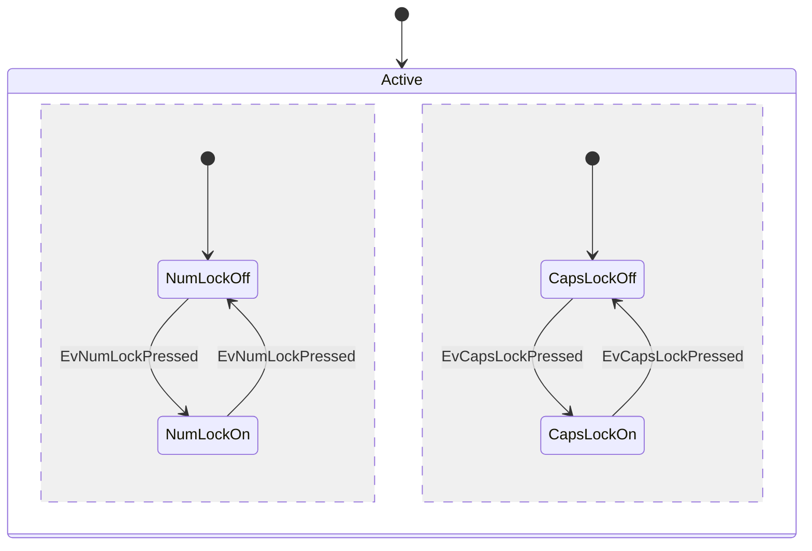

# State diagrams

Keyword: `stateDiagram-v2` (newer renderer) or `stateDiagram` (older renderer). PlantUML-like syntax. Since v12.0.0 state diagrams default to the `redux-color` theme, `neo` look, and ELK layout.

Sources: `docs/syntax/stateDiagram.md` at mermaid@12.3.0.

## Basics

- `[*]` — start and end states.
- Transitions: `A --> B`, labeled `A --> B : event` or `A -- event --> B`.
- `direction LR` (or TD/BT/RL) sets the diagram direction.
- State labels: `NamedComposite: Another Composite` on a separate line.
- Spaces in state names need quotes.

## Composite states

`state <id> { … }` defines a composite state; nest to any depth. Transitions can exist between composite states, but not between internal states belonging to different composite states.

## Choice and forks

Choice uses the `<<choice>>` stereotype; forks use `<<fork>>`/`<<join>>`:

## Notes

## Concurrency

Inside a composite state, `--` on its own line separates concurrent regions:

## Styling

`classDef` + `class` apply CSS-like styles to states (see docs sections "Styling with classDefs" / "Apply classDef styles to states").

## Gotchas

- `stateDiagram-v2` is the richer renderer (composites, concurrency); the old `stateDiagram` keyword still works but with fewer features.
- You cannot define transitions between internal states belonging to different composite states.
- The word `end` is a block terminator — quote or capitalize it in state labels.
