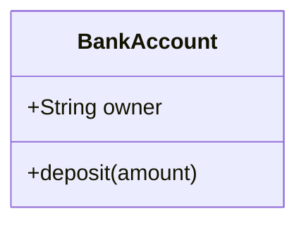
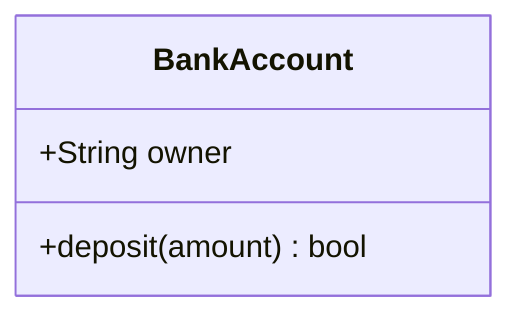
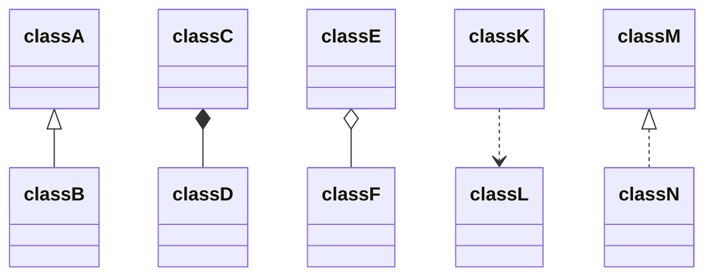
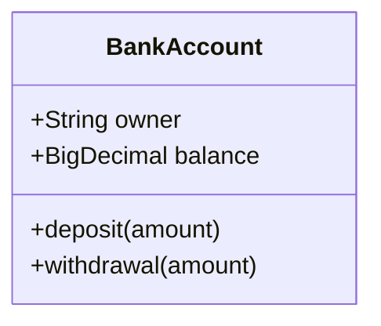

# Class diagrams

Keyword: `classDiagram`. Since v12.0.0 class diagrams default to the `redux-color` theme, `neo` look, and ELK layout.

Sources: `docs/syntax/classDiagram.md` at mermaid@12.3.0.

## Classes and members

Two ways to define a class: `class Animal` explicitly, or via a relationship (`Vehicle <|-- Car` defines both classes). Class names: alphanumerics (incl. unicode), underscores, dashes.

Labels: `class Animal["Animal with a label"]` or backtick-quoted names for special characters: `` class `Animal Class!` ``.

Members — methods are those containing `()`, everything else is an attribute. Two syntaxes:

- Visibility prefix: `+` public, `-` private, `#` protected, `~` package.
- Return type after methods: `deposit(amount) bool` (space before the type).
- Classifiers after `()` or the return type: `*` abstract, `$` static (fields: trailing `$`).
- Generics with `~`: `class Square~Shape~`, `List~int~`; nested `List~List~int~~` works; commas in generics are not supported. Two classes with the same name but different generics are not supported.

## Relationships

| Type | Description |
|---|---|
| `<\|--` | Inheritance |
| `*--` | Composition |
| `o--` | Aggregation |
| `-->` | Association |
| `--` | Link (solid) |
| `..>` | Dependency |
| `..\|>` | Realization |
| `..` | Link (dashed) |

Arrowheads may point the other way (`classG <-- classH`). Labels: `classA --|> classB : Inheritance`.

## Namespaces, interfaces, cardinality, annotations

- Namespaces: `namespace <name> { … }`; labels since v11.15.0; nested namespaces since v11.15.0 (see docs sections "Define Namespace" / "Nested Namespaces").
- Lollipop interfaces: see docs "Lollipop Interfaces".
- Cardinality/multiplicity on relations: e.g. `A "1" --> "many" B` forms (see docs "Cardinality / Multiplicity on relations").
- Annotations: `<<enumeration>>`, `<<abstract>>` stereotypes after the class name (docs "Annotations on classes").
- `direction LR` sets orientation.

## Styling

`style <class> <css>` and `classDef`/`class` apply fill/stroke/etc. (docs "Styling" and "CSS Classes").

## Verified examples

Bank example (docs):

E-commerce domain model — see `all-examples.md` "Class Diagram" section for the full verified example (basic inheritance + e-commerce).

## Gotchas

- Members with `()` are methods; without, attributes — no other way to distinguish.
- Generic types are not part of the class name: reference the class without the `~Type~` part.
- Members box can be hidden per class with `hideEmptyMembersBox` config.
