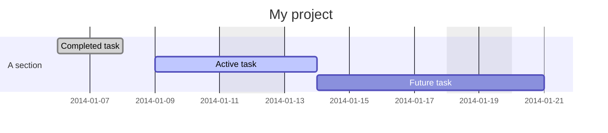
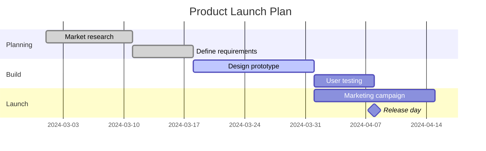
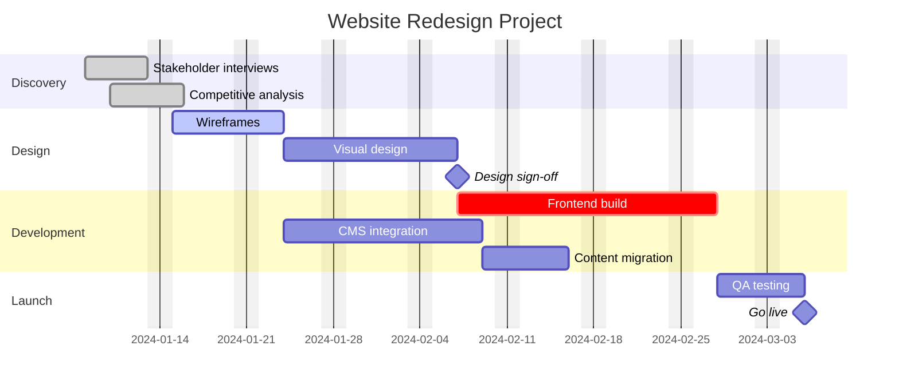

# Gantt charts

Keyword: `gantt`.

Sources: `docs/syntax/gantt.md` at mermaid@12.3.0.

## Structure

- `dateFormat` sets the accepted date format.
- `title` is optional.
- `excludes` accepts specific dates (per `dateFormat`), day names (`sunday`), or `weekends` (not the word `weekdays`). Multiple `excludes` lines concatenate. `weekend friday` (or `saturday`) sets the weekend start day (v11.0.0+).
- `section <name>` groups tasks; tasks are sequential by default — a task's start defaults to the end of the preceding task.

## Task metadata

`Task title : <tags>, <id>, <start>, <end-or-length>` — tags first (`done`, `active`, `crit`, `milestone`), then optional id, start, end. Start can be a date or `after <taskID>` (multiple ids allowed); end can be a date, a duration, or `until <taskID>` (v10.9.0+).

| Metadata syntax | Start | End |
|---|---|---|
| `<taskID>, <startDate>, <endDate>` | startDate | endDate |
| `<taskID>, <startDate>, <length>` | startDate | start + length |
| `<taskID>, after <otherID>, <endDate>` | end of otherID | endDate |
| `<taskID>, after <otherID>, <length>` | end of otherID | start + length |
| `<startDate>, until <otherID>` | startDate | start of otherID |
| `<endDate>` | end of preceding task | endDate |
| `<length>` | end of preceding task | start + length |

Durations: number + unit suffix `ms`, `s`, `m`, `h`, `d`, `w`, `M` (months), `y`; decimals supported (`1.5d`); invalid tokens give zero duration.

## Milestones and vertical markers

`:milestone, id, date, 0d` marks a milestone. The `vert` keyword adds vertical reference lines (no row consumed):

```mermaid
gantt
    dateFormat HH:mm
    axisFormat %H:%M
    Initial vert : vert, v1, 17:30, 2m
    Task A : 3m
    Task B : 8m
    Final vert : vert, v2, 17:58, 4m
```

## Styling and interaction

`classDef`/`class` on tasks; `themeCSS` for custom CSS (e.g. `#item36 { fill: CadetBlue }`); today marker is drawn automatically. Interaction (clicks/tooltips) is available per the docs "Interaction" section.

Config params (docs "Configuration"): `barHeight`, `topPadding`, `leftPadding`, `gridPadding`, `dateFormat`, `numberSectionStyles`, `useWidth`, `axisFormat`, `tickInterval`, `displayWeekdayNames`, `excludeWeekends`, `weekend`, `titleTopMargin`, `enableTooltip`, `todayMarker` … (see the full table in the docs).

## Verified examples

Product launch plan (all-examples):

Website redesign with dependencies (all-examples) — note `after frontend content` chains on two tasks:

## Gotchas

- Tasks without explicit dates are sequential from the previous task's end — a single missing `after` chain is the most common surprise.
- `excludes weekends` + a duration shifts the task end so the duration holds.
- Comments are `%%` lines.
