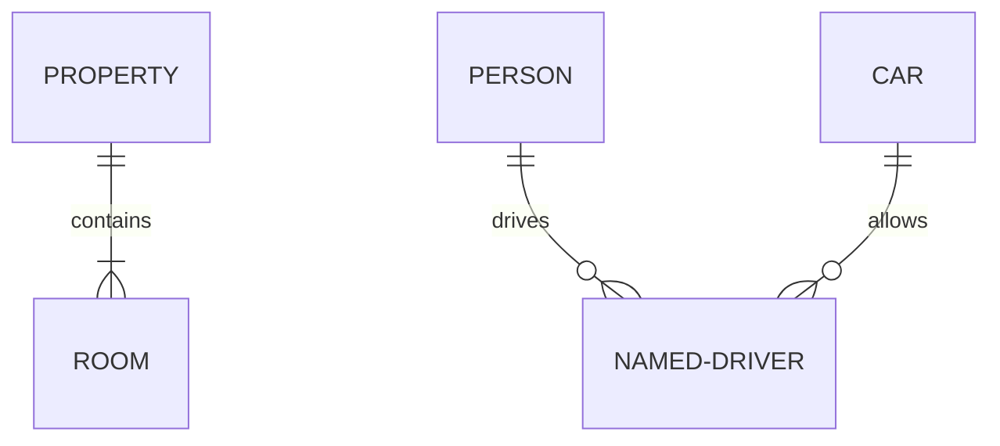
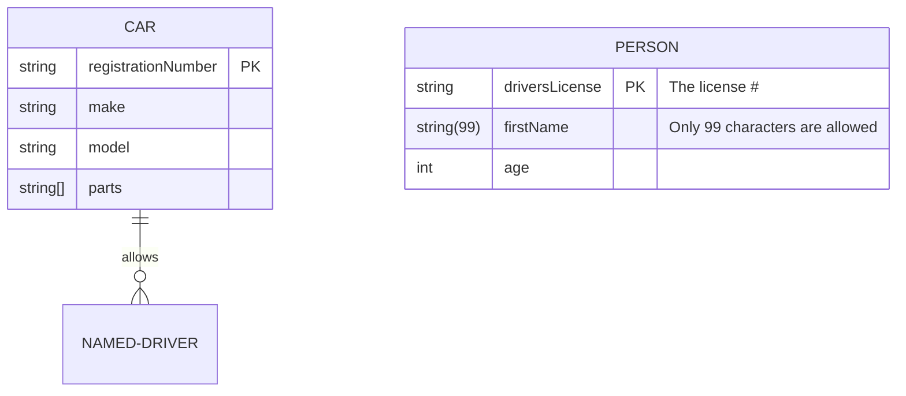
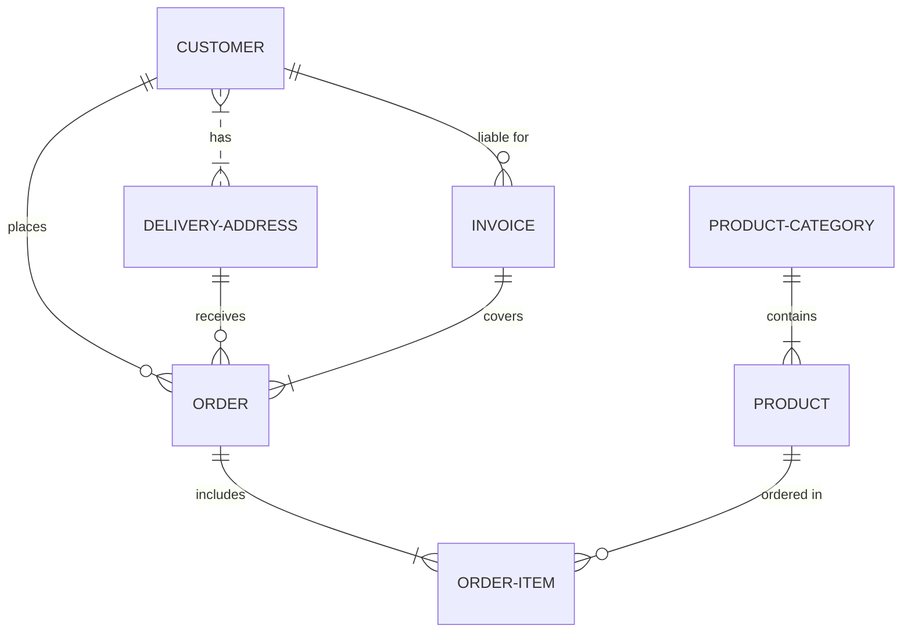

# Entity-relationship diagrams

Keyword: `erDiagram`. PlantUML-compatible syntax plus relationship labels. Since v12.0.0 ER diagrams default to the `redux-color` theme, `neo` look, and ELK layout.

Sources: `docs/syntax/entityRelationshipDiagram.md` at mermaid@12.3.0.

## Entities and relationships

`<first-entity> <relationship> <second-entity> : <label>` — only the first entity is mandatory (for entities with no relationships). Labels read from the first entity's perspective. Entity names support unicode; quote names containing spaces.

Cardinality markers (outer char = max, inner char = min):

| Left | Right | Meaning |
|---|---|---|
| `\|o` | `o\|` | zero or one |
| `\|\|` | `\|\|` | exactly one |
| `}o` | `o{` | zero or more |
| `}\|` | `\|{` | one or more |

Word aliases exist (`one or zero`, `1+`, `many(0)` etc.). Identifying (solid) vs non-identifying (dashed) relationships use `--` vs `..` in the middle: `PERSON }|..|{ CAR` is non-identifying; hyphens (`-`) give solid lines.

`direction TB`/`BT` sets orientation.

## Attributes

Entity attributes go in a `{ … }` block: `type name` pairs, rendered inside the entity box.

- Keys: `PK`, `FK`, `UK`; multiple with commas (`PK, FK`). Trailing double-quoted string is a comment.
- Optional/nullable types (v11.16.0+): `string? middleName`.
- Entity aliases: `p[Person] { … }` or `a["Customer Account"] { … }`.
- Markdown and unicode in entity names/attributes when quoted.

## Subgraphs (v11.17.0+)

Entities can be grouped in subgraphs (see docs "Subgraphs" section for the block syntax).

## Verified examples

Basic ER schema (from the syntax-reference example):

Streaming service with keys and comments — see all-examples "Entity Relationship Diagram" section for the full verified block.

## Gotchas

- Labels with special characters need quotes: `"liable for"`.
- `type` must start alphabetic; `name` may start with `*` to mark a primary key.
- Only the first entity of a statement can stand alone; once you add a relationship all parts are mandatory.
