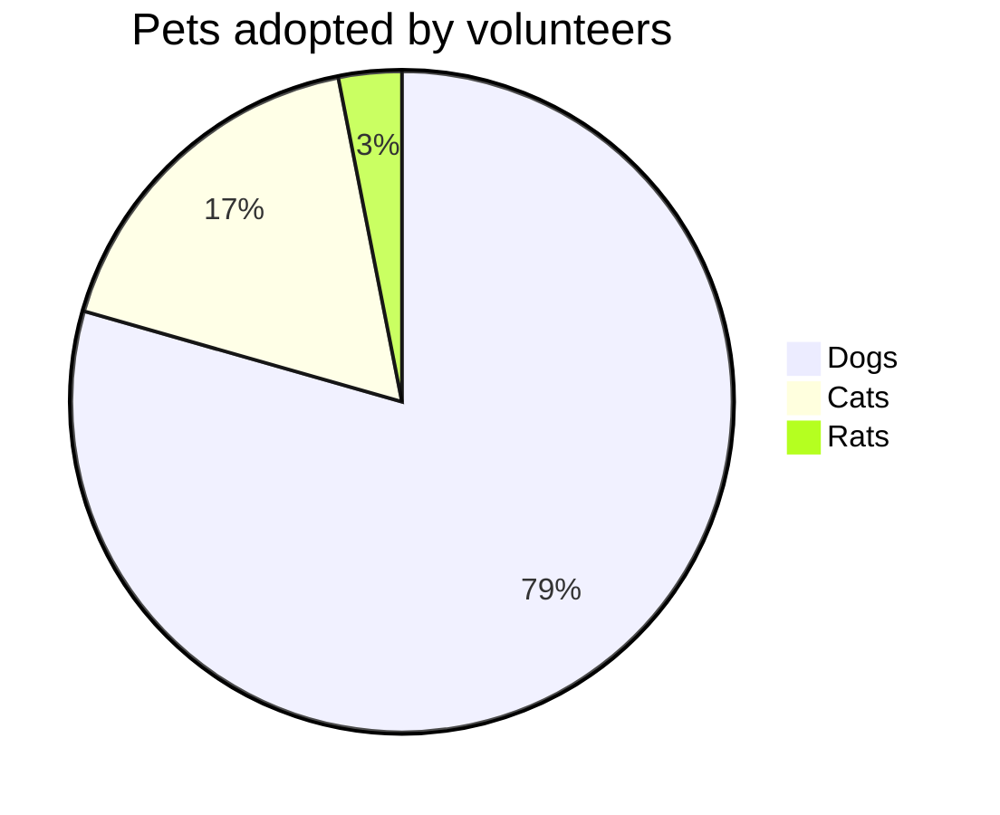
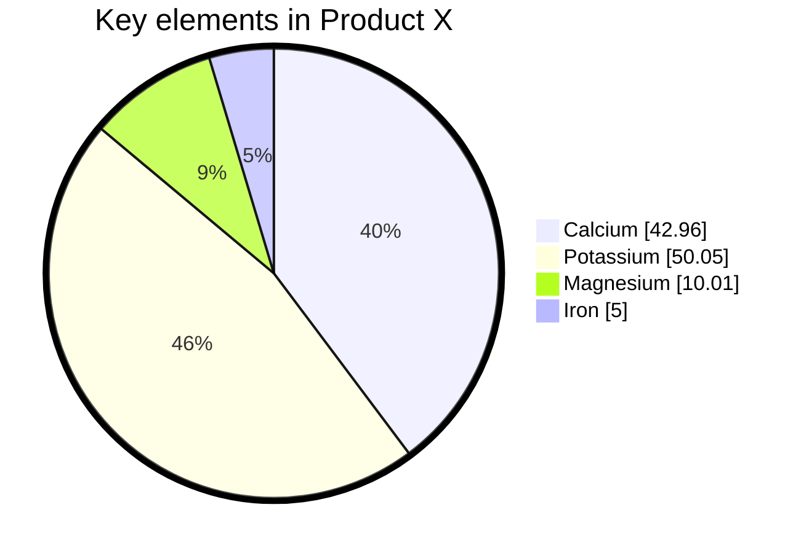

# Pie charts

Keyword: `pie`.

Sources: `docs/syntax/pie.md` at mermaid@12.3.0.

## Syntax

- `pie` keyword, then optional `showData` (render data values), then optional `title <text>`.
- Slices: `"label" : value` — value must be a positive number (two decimal places max). Slices render clockwise in listed order.

## Donut, legend, highlight (v11.16.0+)

Config params: `textPosition` (0.0–1.0, default 0.75), `donutHole` (0–0.9), `legendPosition` (`top`/`bottom`/`left`/`right`/`center`, default `right`), `highlightSlice` (label name or `hover`).

## Verified examples

Workday breakdown with values — see all-examples "Pie Chart" section for the full verified block.

## Gotchas

- Negative or zero values error out.
- Pie slice colors come from theme variables `pie1`…`pie12`.
