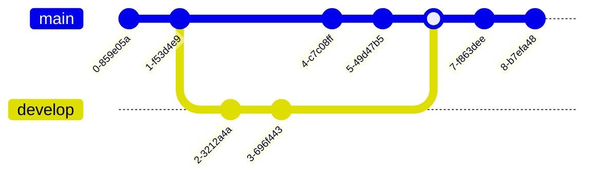
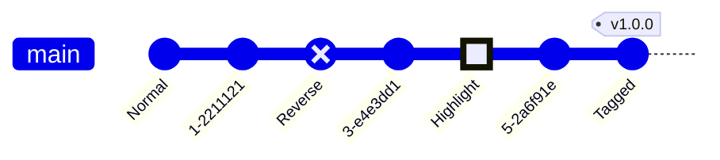
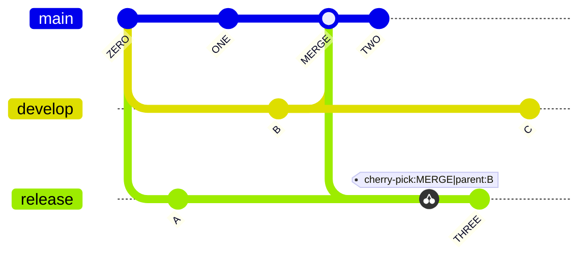

# Git graphs

Keyword: `gitGraph` (optionally `gitGraph LR:`, `TB:`, or `BT:` for orientation). Starts on the `main` branch, which is the current branch.

Sources: `docs/syntax/gitgraph.md` at mermaid@12.3.0.

## Commands

- `commit` — new commit on the current branch.
- `branch <name>` — create **and switch to** a new branch.
- `checkout <name>` — switch to an existing branch (`switch` works interchangeably).
- `merge <name>` — merge an existing branch into the current branch; produces a merge commit (filled double circle). Cannot merge a branch with itself.
- `cherry-pick id: "<commitId>"` — cherry-pick an existing commit (by its declared `id`) from another branch onto the current branch; rendered with a cherry and the source tag. For merge commits, `parent: "<id>"` is mandatory and must be an immediate parent.

## Commit attributes

`commit id: "Alpha" type: HIGHLIGHT tag: "v1.0.0"` — combinable:

- `id: "..."` custom commit id (needed for cherry-pick references).
- `type: NORMAL` (default, solid circle) | `REVERSE` (crossed circle) | `HIGHLIGHT` (filled rectangle).
- `tag: "..."` tag/release marker.

Merges accept the same attributes: `merge develop id: "my_id" tag: "my_tag" type: REVERSE`.

## Verified examples

Basic (docs):

With custom ids, types, and tags (docs):

Cherry-pick (docs example):

(See the docs cherry-pick section for the full multi-branch verified example.)

## Orientation and config

`gitGraph LR:` (default), `TB:`, `BT:` (v11.0.0+). GitGraph config options (docs "GitGraph specific configuration options"): `mainBranchName`, `showBranches`, `showCommitLabel`, `rotateLabel`, `parallelCommits`, `logCompression`, branch ordering, etc. Themes: base, forest, default, dark, neutral with theme variables for branch colors.

## Gotchas

- `branch` switches to the new branch — unlike some other tools, you do not need a following `checkout`.
- Cherry-pick requires the source commit to have a declared `id`, to live on a different branch, and the current branch to have at least one commit.
- Commit labels can be hidden/rotated via config; parallel commits change when commits draw (docs "Parallel commits").
