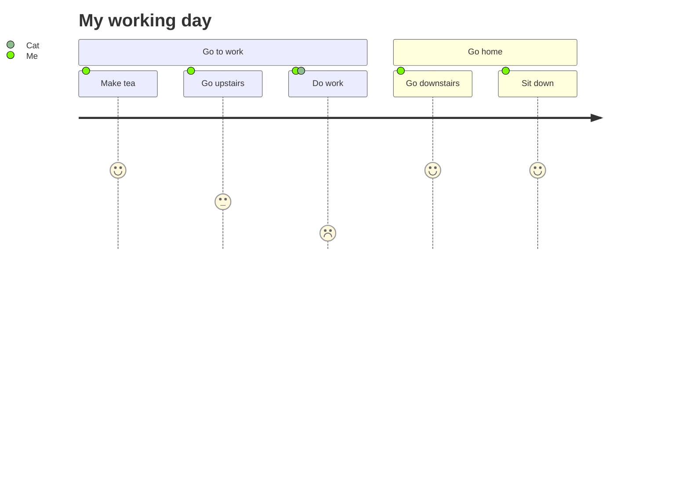

# User journey diagrams

Keyword: `journey`.

Sources: `docs/syntax/userJourney.md`, `docs/syntax/all-examples.md` at mermaid@12.3.0.

## Syntax

A journey is split into `section`s. Each task line: `Task name: <score>: <comma separated list of actors>` where the score is 1–5 inclusive.

## Verified examples

Online grocery shopping — see all-examples "User Journey Diagram" section for the full verified block.

## Gotchas

- Scores are 1–5; the first score encountered per task is what matters.
- Actor lists are comma-separated and display under the task.
