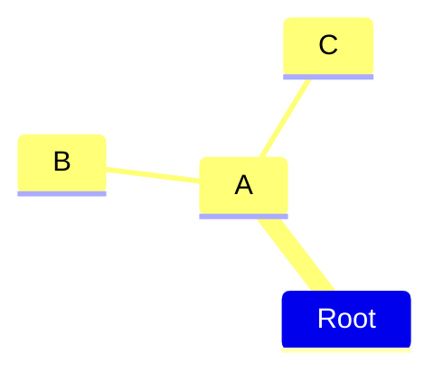
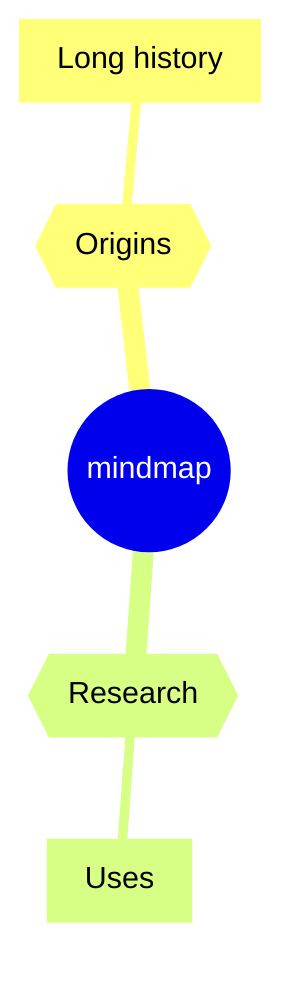
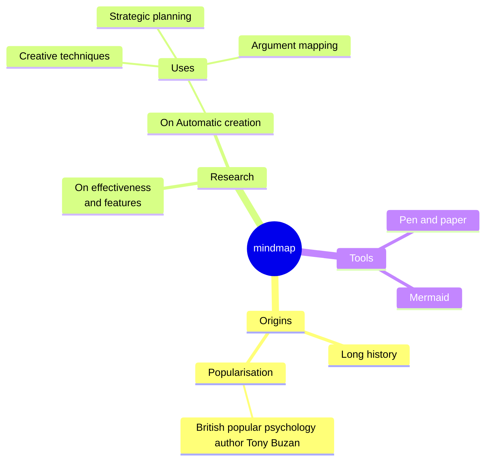

# Mindmaps

Keyword: `mindmap`. Hierarchy is defined by indentation; the root is the least-indented node. Indentation only matters relative to the previous lines. Mindmaps keep their own `cose-bilkent` layout unless a layout is explicitly set (the tiny build falls back to Dagre); a `tidy-tree` layout is available via config (see `docs/config/tidy-tree.md`).

Sources: `docs/syntax/mindmap.md` at mermaid@12.3.0.

## Basic syntax

## Shapes

Flowchart-like shape delimiters:

- `id` — default node
- `id[I am a square]` — square
- `id(I am a rounded square)` — rounded square
- `id((I am a circle))` — circle
- `id))I am a bang((` — bang
- `id)I am a cloud( ` — cloud
- `id{{I am a hexagon}}` — hexagon

## Icons, classes, markdown

- Icons: `::icon(fa fa-book)` or `::icon(mdi mdi-skull-outline)` on their own line after a node (icon fonts must be loaded by the integrator).
- Classes: `:::urgent large` (space-separated CSS classes supplied by the site).
- Markdown strings and multi-line text are supported (docs "Markdown Strings").
- ` ` for line breaks.

## Coloring by depth (v12.2.0+)

Default: each top-level branch gets its own color and descendants inherit it. `mindmap.colorBy: depth` colors by hierarchy level instead:

## Verified examples

From the docs:

Trip planning with shapes and icons — see all-examples "Mindmap" section for the full verified block.
