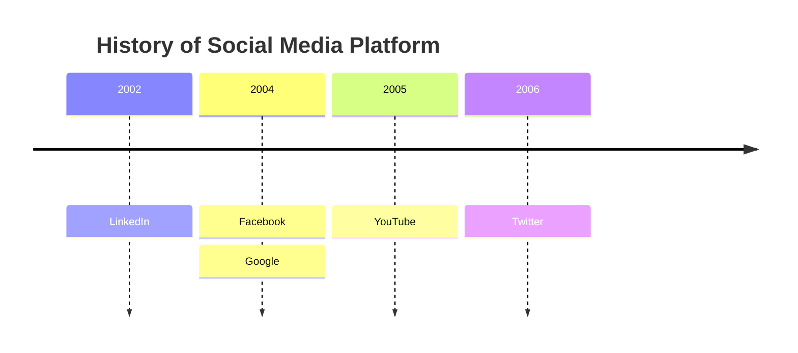
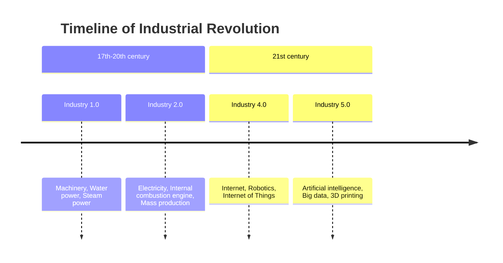

# Timelines

Keyword: `timeline`.

Sources: `docs/syntax/timeline.md`, `docs/syntax/all-examples.md` at mermaid@12.3.0.

## Syntax

`{time period} : {event}` — multiple events per period via extra colons or repeated `: event` lines. Time periods and events are plain text (not just numbers). First period on the left, last on the right; first event on top for a period, last at the bottom.

## Sections

`section <name>` groups subsequent time periods (like gantt):

## Verified examples

Product roadmap with sections — see all-examples "Timeline Diagram" section for the full verified block.
