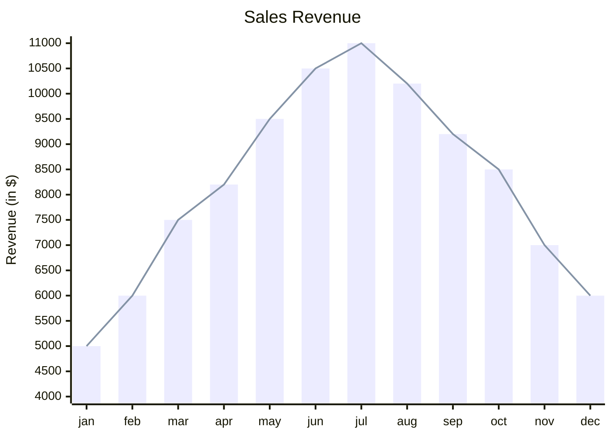
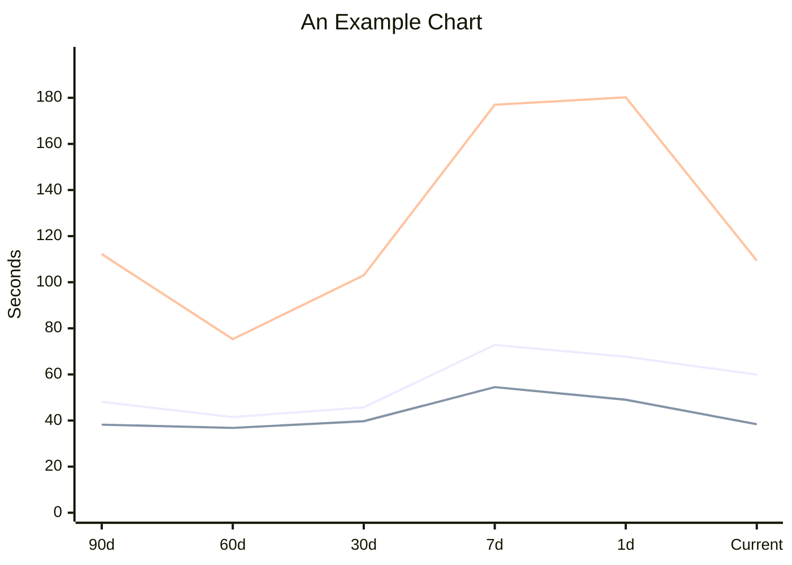

# XY charts (bar and line)

Keyword: `xychart` (optionally `xychart horizontal`).

Sources: `docs/syntax/xyChart.md` at mermaid@12.3.0.

## Syntax

- `title "..."` — quote multi-word titles.
- `x-axis` — categorical `["jan", "feb", …]` or numeric `min --> max`.
- `y-axis` — numeric range `"label" min --> max` or just a label (range auto from data).
- `bar [values]` / `line [values]` — plots; `bar "series name" [values]` adds a legend entry (v11.17.0+). Named line/bar series appear in a legend automatically.
- Both axes are optional — ranges are inferred from data.

## Verified examples

Legend example (docs):

Sales revenue and sign-ups-vs-churn examples — see all-examples "XY Chart" section for the full verified blocks.
