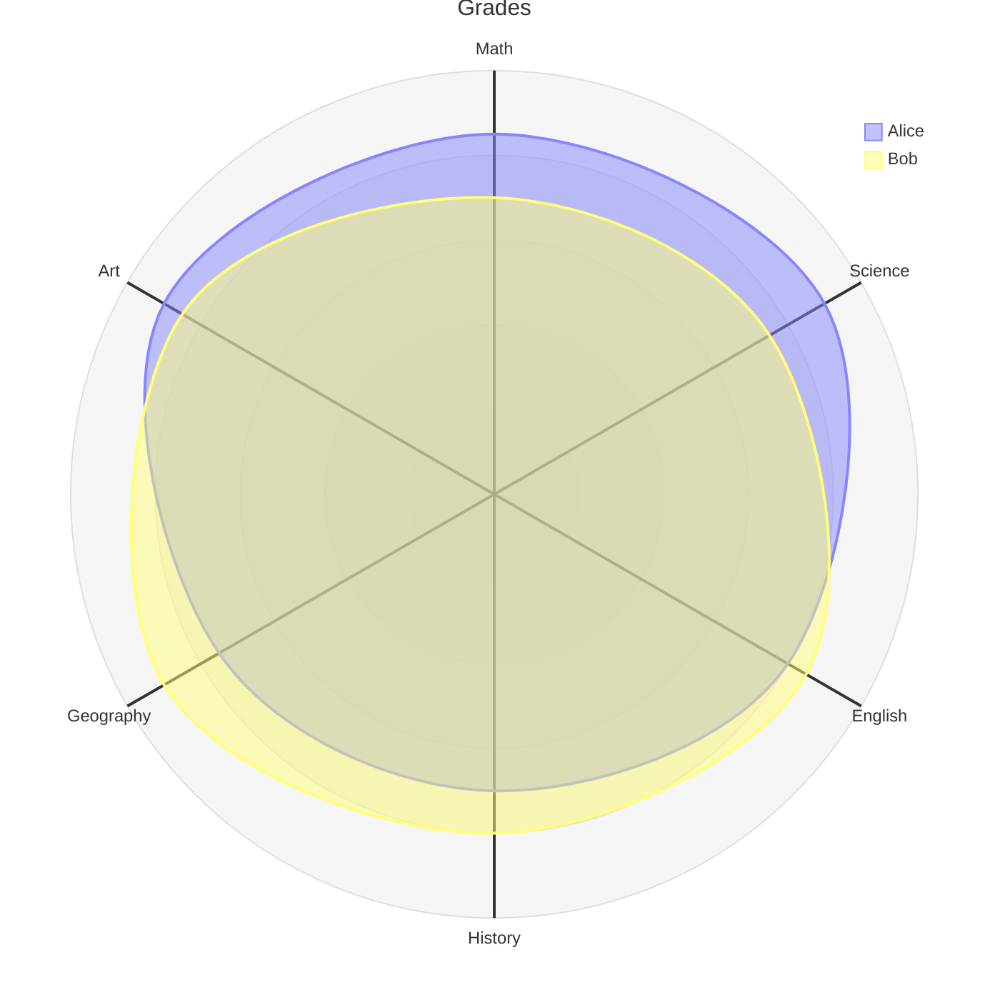
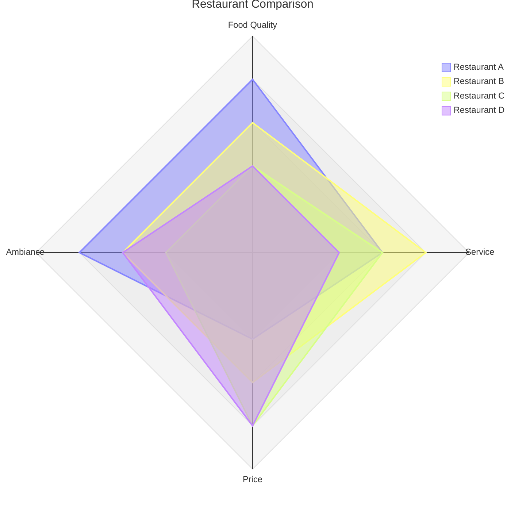

# Radar charts

Keyword: `radar-beta` (beta — the plain keyword may change before stable).

Sources: `docs/syntax/radar.md` at mermaid@12.3.0.

## Syntax

```
radar-beta
  title <optional title>
  axis <id>["label"], <id>["label"], ...
  curve <id>["label"]{v1, v2, ...}
  graticule polygon
  max <n>
  min <n>
```

- `axis` defines spokes; multiple axes per line. Labels optional (bare id or `id["Label"]`).
- `curve` plots one series per line; values align to the axes in order.
- `max`/`min` bound the scale.
- `graticule polygon` renders a polygon grid (verified form; other graticule values, if any, are not documented here).



Restaurant comparison (docs):


