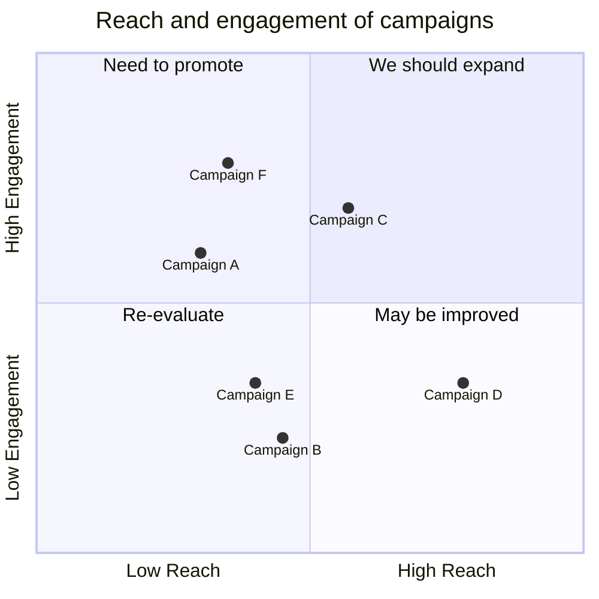

# Quadrant charts

Keyword: `quadrantChart`.

Sources: `docs/syntax/quadrantChart.md` at mermaid@12.3.0.

## Syntax

- `title <text>`
- `x-axis <left> --> <right>` (right optional)
- `y-axis <bottom> --> <top>` (top optional)
- `quadrant-1 <text>` … `quadrant-4 <text>` — quadrant labels (1 = top-right, 2 = top-left, 3 = bottom-left, 4 = bottom-right)
- Points: `<label>: [x, y]` with x, y in 0–1.

## Verified examples

Eisenhower matrix with styled points — see all-examples "Quadrant Chart" section for the full verified block.
