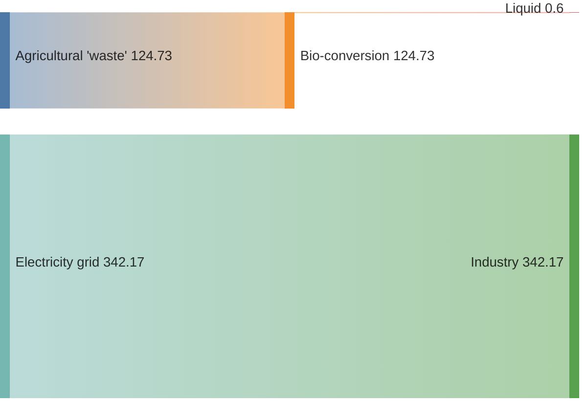

# Sankey diagrams

Keyword: `sankey`. Flows from one set of values to another; each line is `source, target, value`.

Sources: `docs/syntax/sankey.md`, `docs/syntax/all-examples.md` at mermaid@12.3.0.

## Syntax

- Node names with spaces are quoted (`'…'` or `"…"`).
- Values are the flow magnitudes; layout is computed automatically.
- Config: `sankey: { showValues: false }` and other params (see the config schema guide referenced by the docs).

## Verified examples

Monthly budget flow and job application funnel — see all-examples "Sankey Diagram" section for the full verified blocks.
