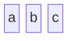
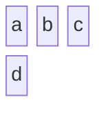
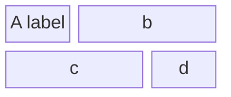
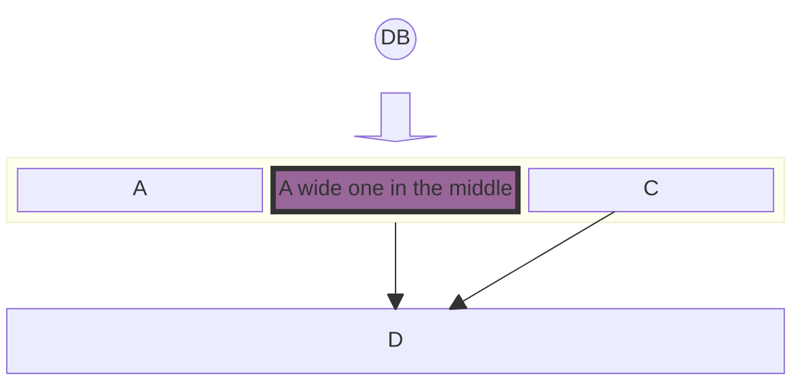

# Block diagrams

Keyword: `block`. Unlike flowcharts, block diagrams give the author full control over position: items flow row by row across the declared column grid.

Sources: `docs/syntax/block.md` at mermaid@12.3.0.

## Basics

Items on one line are placed left to right; new lines start new rows. `columns N` sets the grid width; items wrap.

## Widths, nesting, arrows

- A block can span multiple columns with `id:2`:

- Nested blocks: `block:ID` … `end` creates a composite block addressable by `ID` (used in edge statements like `ID --> D`).
- `space` reserves an empty cell.
- Block arrows: `blockArrowId<["&nbsp;&nbsp;&nbsp;"]>(down)` draws an arrow element with a label and direction.
- Edges: `A --> B`, `A -- B`, `A --> B` style operators between blocks.
- Styling: `style B fill:#969,stroke:#333,stroke-width:4px`.

## Verified examples

From the docs intro:

Three-tier web architecture and block arrows/nested blocks — see all-examples "Block Diagram" section for the full verified blocks.

## Gotchas

- Layout is positional and grid-based — the order of items determines placement; there is no automatic node routing like flowchart ELK.
- Node shape syntax from flowcharts is used for individual blocks (e.g. `db(("DB"))`).
