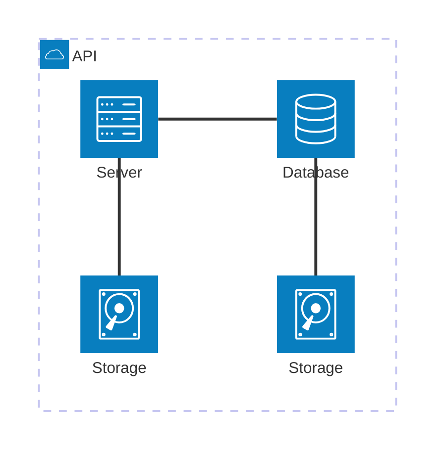

# Architecture diagrams (cloud)

Keyword: `architecture-beta` (beta). Shows services and resources in cloud or CI/CD deployments: groups, services, edges, junctions.

Sources: `docs/syntax/architecture.md` at mermaid@12.3.0.

## Syntax

- Groups: `group <id>(<icon>)[<title>] (in <parent>)?`
- Services: `service <id>(<icon>)[<title>] (in <group>)?`
- Edges: `{serviceId}{group}?:{T|B|L|R} {<}?--{>}? {T|B|L|R}:{serviceId}{group}?`
  - Side is set with `:` + `T|B|L|R` on each end.
  - Arrows: `<` before the left direction, `>` after the right direction (`db:R --> L:server`).
  - Group-level edges: append `{{group}}` after a service id (docs "Edges out of Groups").
- Junctions exist as a building block (see docs) for routing multiple edges.

Icons are declared in `()`, labels in `[]`. Building blocks may be declared in any order, but identifiers must already be declared by their components.

## Verified examples

From the docs:

Web app with frontend/backend groups and load balancing with junctions — see all-examples "Architecture Diagram" section for the full verified blocks.

## Gotchas

- Direction letters `T|B|L|R` are required on edges — they are how the renderer docks the line to a face of the service.
- Architecture diagrams are omitted from the **tiny** build.
