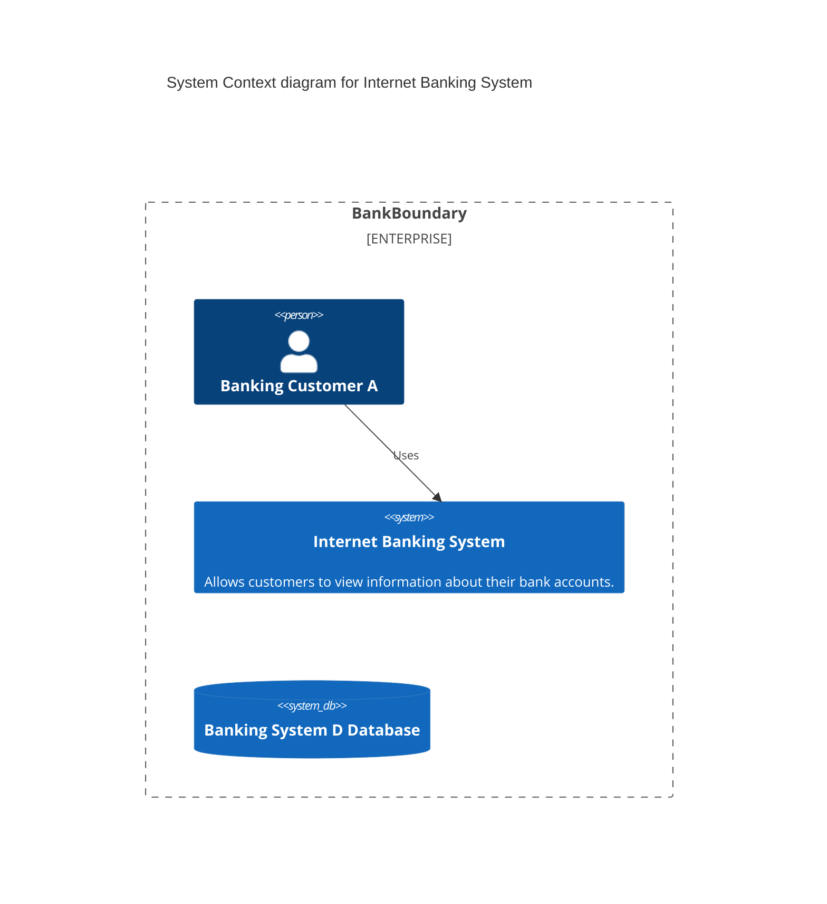

# C4 diagrams

Keywords: `C4Context`, `C4Container`, `C4Component`, `C4Dynamic`, `C4Deployment`. Syntax is compatible with C4-PlantUML (see the [C4-PlantUML syntax](https://github.com/plantuml-stdlib/C4-PlantUML/blob/master/README.md)).

Sources: `docs/syntax/c4.md` at mermaid@12.3.0.

## Elements

- Context: `Person`, `Person_Ext`, `System`, `SystemDb`, `SystemQueue`, `System_Ext`, `SystemDb_Ext`, `SystemQueue_Ext`, `Boundary`, `Enterprise_Boundary`, `System_Boundary` — all `(alias, label, ?descr, ...)`.
- Container: `Container`, `ContainerDb`, `ContainerQueue`, `Container_Ext`, `ContainerDb_Ext`, `ContainerQueue_Ext`, `Container_Boundary`.
- Component: `Component`, `ComponentDb`, `ComponentQueue`, `Component_Ext`, `ComponentDb_Ext`, `ComponentQueue_Ext`.
- Deployment: `Deployment_Node` (alias `Node`), `Node_L`, `Node_R`.
- Relationships: `Rel(from, to, label, ?techn)`, `BiRel`, directional variants `Rel_U`/`Rel_Up`, `Rel_D`/`Rel_Down`, `Rel_L`/`Rel_Left`, `Rel_R`/`Rel_Right`, `Rel_Back`, `RelIndex` (index ignored; order of statements determines numbering).
- Styling: `UpdateElementStyle(el, $fontColor=…, $bgColor=…, $borderColor=…)`, `UpdateRelStyle(from, to, $textColor=…, $lineColor=…, $offsetX=…, $offsetY=…)`.
- Layout: `UpdateLayoutConfig($c4ShapeInRow="4", $c4BoundaryInRow="2")` — defaults are 4 shapes/row and 2 boundaries/row.

Boundaries nest with `{ … }`.

## Verified examples

Internet banking context (docs, condensed to verified core):

The full verified example (with nested boundaries, ext elements, BiRel, and all Update*Style calls) is in the docs page itself.

## Not supported (per docs)

- Layout statements `Lay_U/D/L/R` — layout is positional via statement order.
- `sprite`, `tags`, `link`, `Legend`, `AddElementTag`/`AddRelTag`, `RoundedBoxShape`/`EightSidedShape`, `DashedLine`/`DottedLine`/`BoldLine`.

## Gotchas

- C4 has fixed styling per element type — no per-theme skins.
- Position is driven by the order you write statements, not an auto-layout.
