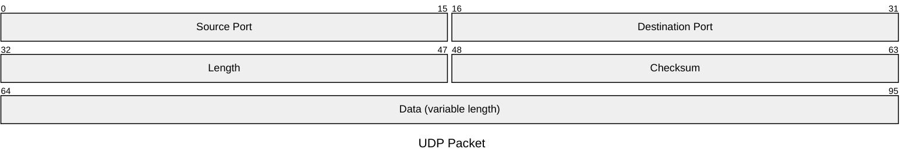
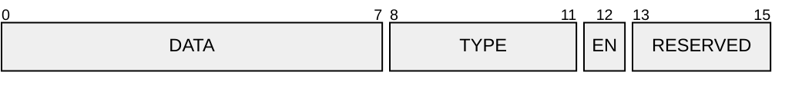
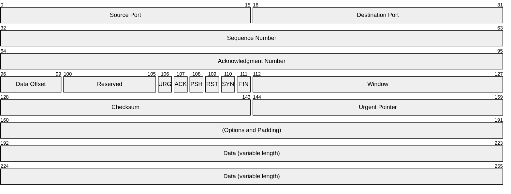

# Packet diagrams

Keyword: `packet`. Illustrates network packet structure as bit fields.

Sources: `docs/syntax/packet.md` at mermaid@12.3.0.

## Syntax

Each line after the optional `title`: `<range>: "Field name"` where the range is `start-end` (e.g. `0-15`), a single bit (`106`), or a relative bit count `+<count>` (v11.7.0+) starting from the end of the previous field. Forms can be mixed.

## Bit numbering (v12.0.0+)

Rows are numbered lowest bit left → highest bit right (network convention). Set `packet: { bitOrder: descending }` to mirror every row (hardware-register convention, MSB left). Fields are still declared lowest bit first (`0-7`, never `7-0`); each row is mirrored independently (with default `bitsPerRow: 32`, the second row runs from bit 63 down to 32).

## Verified examples

TCP packet (docs):

