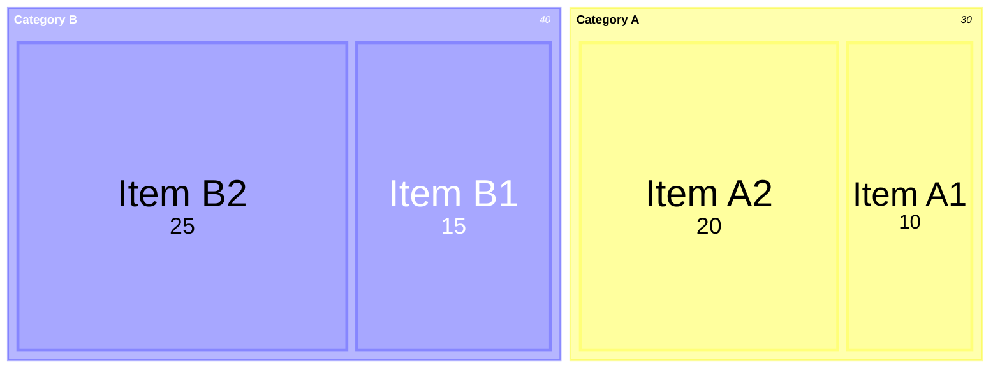
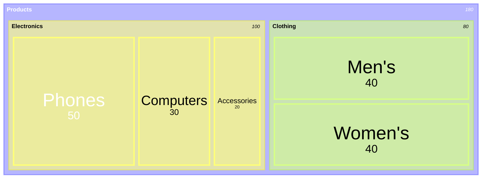
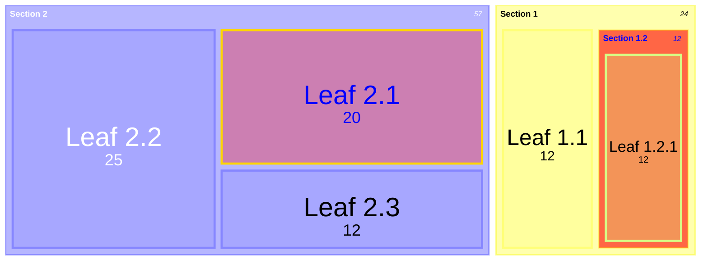

# Treemaps

Keyword: `treemap-beta` (plain `treemap` works too). Hierarchical data as nested rectangles; size proportional to value.

Sources: `docs/syntax/treemap.md` at mermaid@12.3.0.

## Syntax

- Section/parent nodes: quoted text `"Section Name"`.
- Leaf nodes: `"Leaf Name": value`.
- Hierarchy by indentation (spaces or tabs).
- Styling: `:::class` suffix on nodes; `classDef class1 fill:red,color:blue,stroke:#FFD600;`.

Hierarchical with styling (docs):

Styling example:

Monthly household budget and disk usage with styling — see all-examples "Treemap" section for the full verified blocks.
