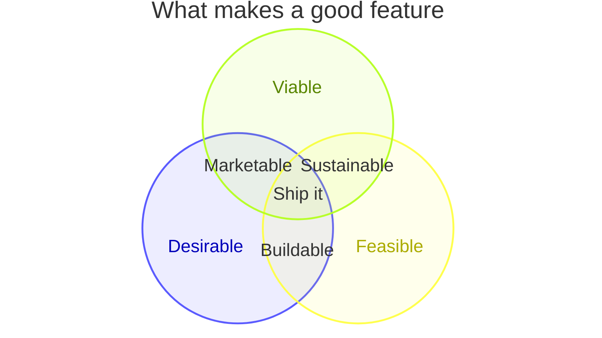
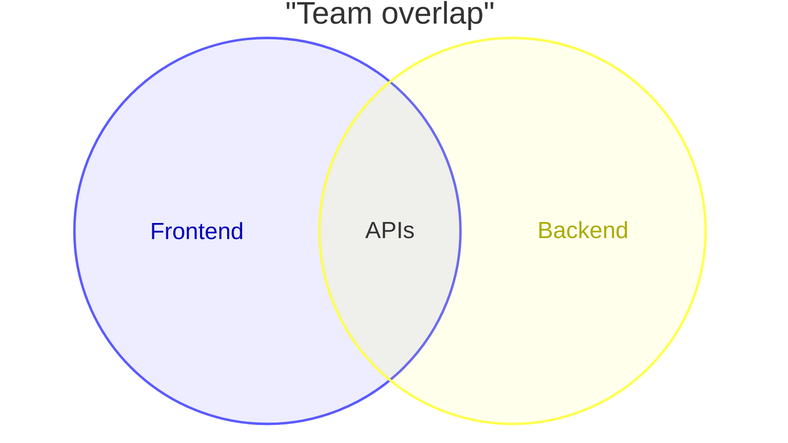

# Venn diagrams

Keyword: `venn-beta` (beta). Since v12.0.0 venn diagrams default to the `redux-color` theme and `neo` look.

Sources: `docs/syntax/venn.md` at mermaid@12.3.0.

## Syntax

- `title <text>` optional.
- `set <name>` declares a set (bare word or quoted string).
- `union <set1>,<set2>[,<set3>...]["label"]` declares an overlap; union identifiers must be defined by earlier `set` lines.

Simple two-set (docs):

Team skill overlap with sizes and styles — see all-examples "Venn Diagram" section for the full verified block.
