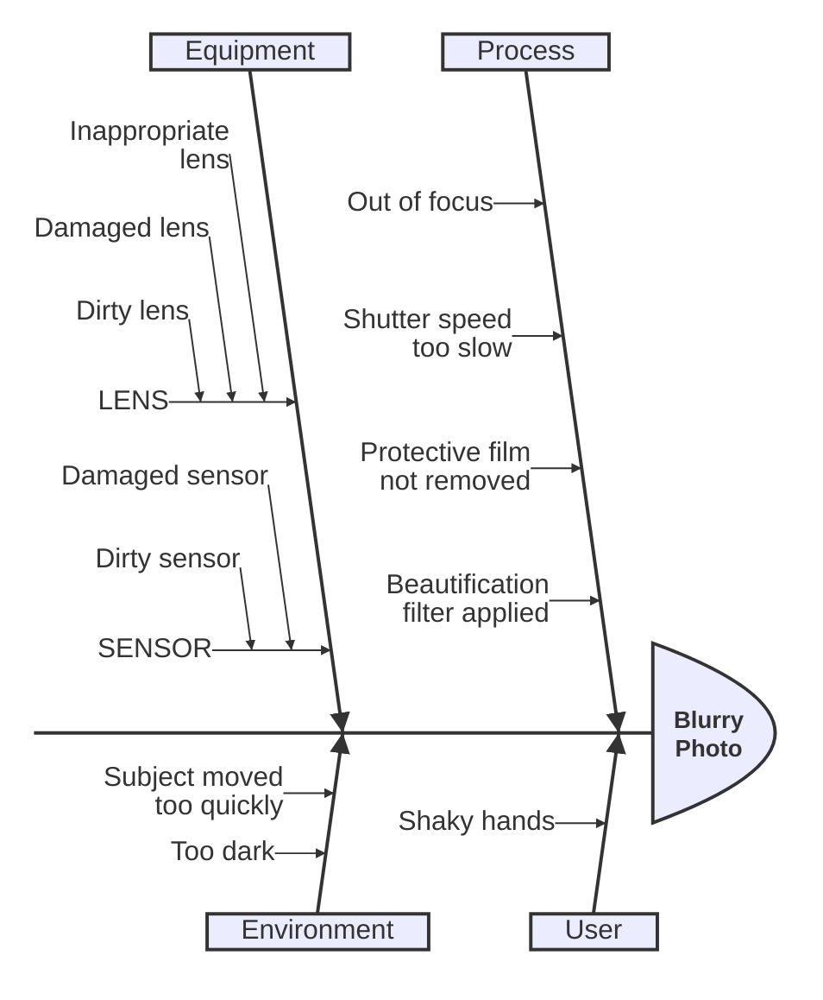

# Ishikawa (fishbone) diagrams

Keyword: `ishikawa-beta` (plain `ishikawa` works too). Cause-and-effect diagrams: the first line is the event/problem; subsequent indented lines are causes; indentation builds the fishbone structure.

Sources: `docs/syntax/ishikawa.md` at mermaid@12.3.0.

## Syntax

Rules (from the docs):
- The first line is the event (problem) of the diagram.
- Subsequent lines are causes of the event.
- The "fishbone" structure is indicated by indentation (causes under category labels like `Process`, `User`, `Equipment`, `Environment`).

Late food delivery root causes — see all-examples "Ishikawa Diagram" section for the second verified block.
