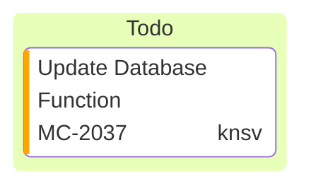
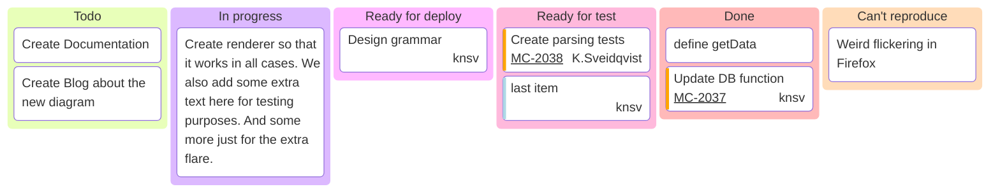

# Kanban diagrams

Keyword: `kanban`. Tasks moving through workflow stages.

Sources: `docs/syntax/kanban.md` at mermaid@12.3.0.

## Syntax

- Columns: `columnId[Column Title]` (id optional — a bare title also works).
- Tasks under a column, indented: `taskId[Task Description]` or bare `[Description]`.
- Task metadata: `@{ key: value, ... }` with supported keys:
  - `assigned` — responsible person
  - `ticket` — ticket/issue number
  - `priority` — `Very High` | `High` | `Low` | `Very Low`

Config: `kanban: { ticketBaseUrl: 'https://…/browse/#TICKET#' }` — `#TICKET#` is replaced with the task's ticket value to build the link.

## Verified examples

Full board (docs):

## Gotchas

- Priority values are case-sensitive strings: `Very High`, `High`, `Low`, `Very Low`.
