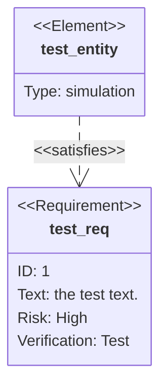
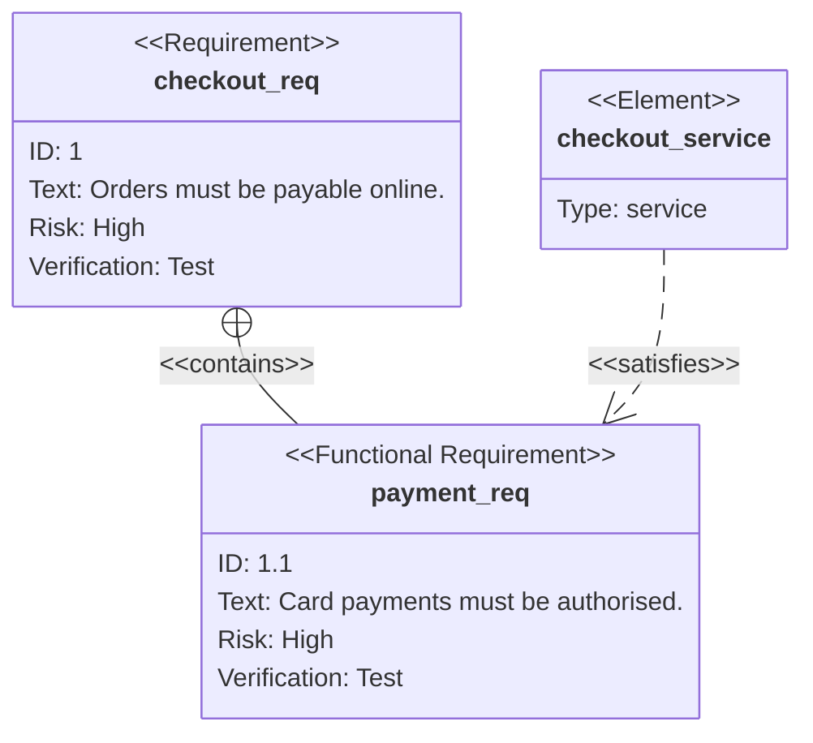

# Requirement diagrams (SysML)

Keyword: `requirementDiagram`. Follows SysML v1.6 modeling specs. Since v12.0.0 requirement diagrams default to the `redux-color` theme, `neo` look, and ELK layout.

Sources: `docs/syntax/requirementDiagram.md` at mermaid@12.3.0.

## Syntax

- `requirement <name> { id: …, text: …, risk: …, verifymethod: … }` — properties in the block (e.g. `id`, `text`, `risk`, `verifymethod`).
- `functionalRequirement` and other requirement types exist (docs "Requirement" section lists the accepted types).
- `element <name> { type: … }` — a system element (e.g. `type: simulation`, `type: service`).
- Markdown formatting is supported in text (docs "Markdown Formatting").
- Relationships: `<from> - <verb> -> <to>` — verbs include `satisfies`, `contains` (docs "Relationship" section lists the accepted verbs).

## Verified examples

Checkout example (docs):

E-bike braking system — see all-examples "Requirement Diagram" section for the full verified block.

`direction TD`/`LR` etc. sets orientation (docs "Direction"). Styling via direct styles and `classDef`/`class` (docs "Styling").
