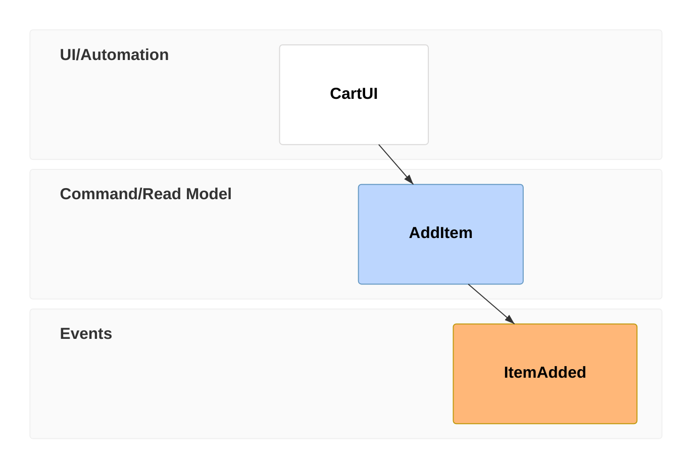
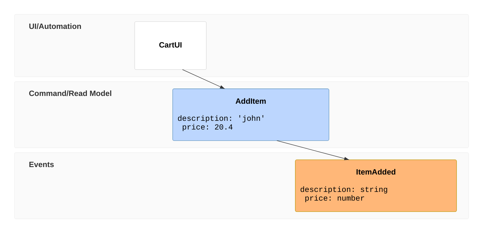

# Event modeling diagrams

Keyword: `eventmodeling`. Describes systems via information flow over time (trigger → command → view → events), organized in inferred swimlanes.

Sources: `docs/syntax/eventmodeling.md` at mermaid@12.3.0.

## Timeline

Time frames are numbered uniquely; order of numbers doesn't matter, uniqueness does (reusing a number errors). Compact tokens: `tf`, `rf` (reset frame); relaxed: `timeframe`, `resetframe`. Entity type is the third column: `ui`, `pcr`/`processor`, `cmd`/`command`, `rmo`/`readmodel`, `evt`/`event`.

Swimlanes are inferred from entity type (UI/Automation, Command/Read Model, Events). A namespace prefix creates new lanes: `Inventory.InventoryChanged` (namespace before the `.`).

## Data

- Inline data on the frame line: `tf 02 cmd AddItem { description: string }`.
- Data blocks referenced by `[[identifier]]`; unique per repeat (`[[AddItem01]]`, `[[AddItem02]]`):

- Data type hint in backticks before `{`: `json`, `jsobj`, `figma`, `salt`, `uri`, `md`, `html`, `text` (no special rendering yet).

## Reset frames and relations

`rf`/`resetframe` stops the inferred relation from the preceding frame; connect explicitly with `->>` to a specific earlier frame. Multiple relations are supported (docs "Multiple relations").

## Patterns

The docs describe the State View, State Change, Translation, and Automation patterns (docs "Event Modeling patterns").

Shopping cart story and cross-system flow — see all-examples "Event Modeling Diagram" section for the full verified blocks.
