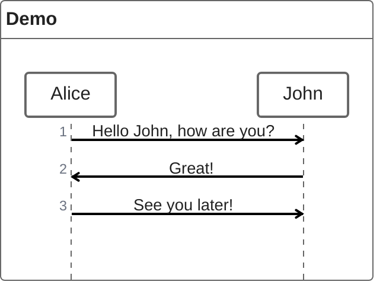
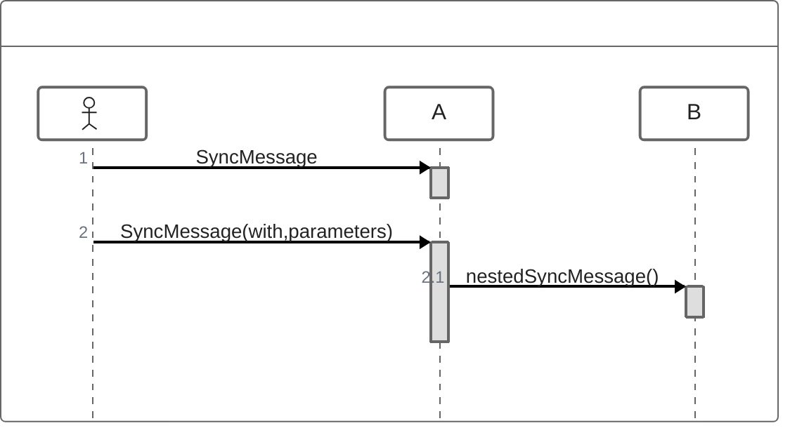
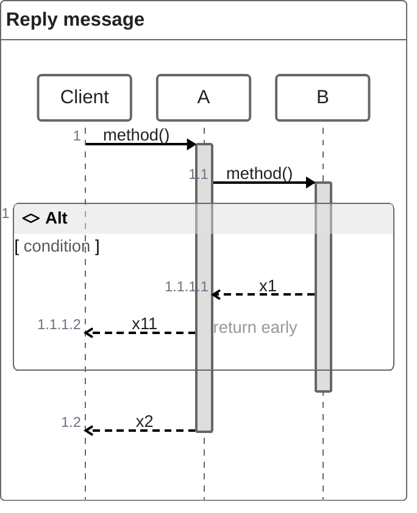

# ZenUML sequence diagrams

Keyword: `zenuml`. Renders sequence diagrams with ZenUML syntax — different from Mermaid's native `sequenceDiagram` syntax.

Sources: `docs/syntax/zenuml.md` at mermaid@12.3.0.

## Basics

- `title <text>` first.
- Participants appear in order of first mention; declare explicitly to control order (`Bob` on its own line).
- Aliases: `A as Alice`.
- Annotators: `@Actor Alice`, `@Database Bob` (and other participant symbols).

## Messages

1. **Sync** — `A.method()` blocks; nestable with `{ … }`:

2. **Async** — `Alice->Bob: How are you?` (fire and forget).
3. **Creation** — `new A1`, `new A2(with, parameters)`.
4. **Reply** — three forms:
   - assign from a sync message: `a = A.SyncMessage()` (optional type: `SomeType a = A.SyncMessage()`)
   - `return result` inside a sync block
   - `@return` annotator on an async message (rare; returns one level up)

## Comments, loops, fragments

- Comments: `// comment` above messages/fragments; markdown supported.
- Loops: `while(condition) { … }`, `for`, `forEach`/`foreach`, `loop`.
- Alt: `if(cond) { … } else if(cond2) { … } else { … }`.
- Optional: `opt { … }`.
- Parallel and other fragments are documented further in the docs page.

## Verified examples

Reply message with nesting (docs):

